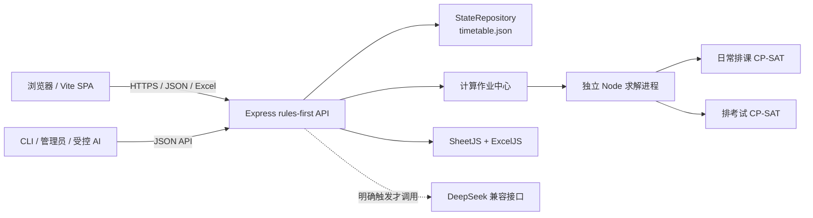
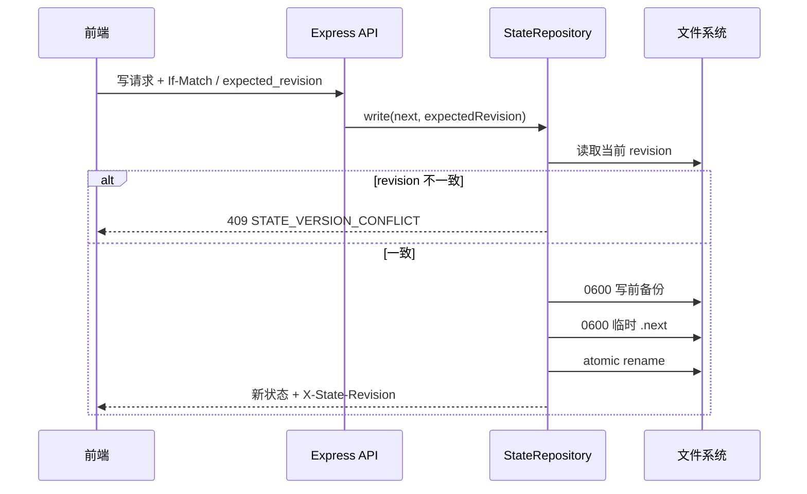
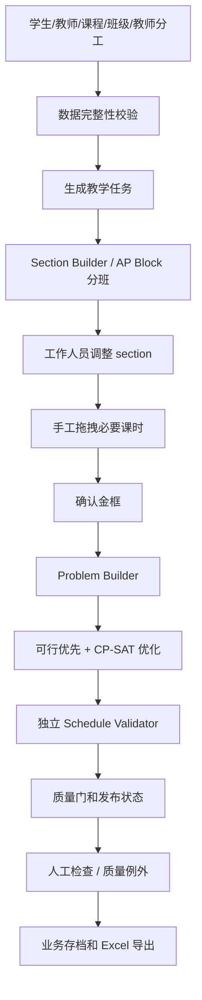

# AP 课程排课与排考试系统：开发交接文档

> 面向：下一位维护、二次开发、部署和排障的程序员
> 文档基线：Git 提交 `34fffd4e80ab157f885276d56be77f2dea39c378`
> 基线日期：2026-08-29
> 主分支：`main`；当前加固分支：`codex/system-reliability-hardening`
> 代码仓库：`https://github.com/Apewin/timetable-system.git`（私有仓库）
> 当前包版本：`0.1.0`，尚未建立正式 SemVer 发布标签体系

本文档是项目的开发交接入口。它说明系统为何这样设计、数据如何流动、两套求解器如何工作、哪些状态可以发布、如何安全修改和部署，以及当前仍然存在的边界与技术债。用户操作说明以 [README.md](./README.md) 为准；安全要求以 [SECURITY.md](./SECURITY.md) 为准；发布门禁以 [RELEASE_CHECKLIST.md](./RELEASE_CHECKLIST.md) 为准；测试证据以文末列出的五份终极验收报告为准。

重要：本文描述的是提交 `34fffd4` 的事实。后续修改代码、数据 schema、生产环境或业务规则后，应同步更新本文的“文档基线”和相关章节，避免它退化为历史说明。

---

## 1. 十分钟接管摘要

### 1.1 这是什么系统

这是一个面向单所国际课程学校的教务系统，核心包含两个彼此独立的业务时间域：

1. **日常教学周排课**：管理学生、教师、课程、行政班、教学班、AP/其他选修、教师分工、规则、手工金框条件，并生成和导出全校课表。
2. **考试周排考**：导入三个年级的考试科目与时长，在 3–5 天考试窗口内排考试时间，再分配考场、座次、巡考/主考和监考任务并导出 Excel。

两者共享学生、教师、课程和分工数据，但**日常课表与考试周时间不互相冲突检查**。这是明确的业务要求，不是遗漏。

### 1.2 运行架构一句话

前端和 CLI 都只调用一个 Express 后端；后端把学校状态保存在单个 JSON 文件中，使用 OR-Tools CP-SAT 进行确定性求解，写入前做独立校验、revision 并发检查、原子替换和自动备份。



### 1.3 当前代码与生产快照

截至基线提交：

| 项目 | 状态 |
| --- | --- |
| 本机 `HEAD` | `34fffd4e80ab157f885276d56be77f2dea39c378` |
| 本机 `main` | 同上 |
| GitHub `origin/main` | 同上 |
| GitHub 加固分支 | 同上 |
| 办公室主机 | `sdshiyanAP`，内网 IP `192.168.31.7` |
| 办公室入口 | `https://192.168.31.7/` |
| 办公室发布目录 | `/opt/timetable/releases/20260829-34fffd4` |
| 办公室当前软链接 | `/opt/timetable/current` → 上述发布目录 |
| systemd | `timetable`、`nginx`、`timetable-backup.timer` 最终验收时均为 `active` |
| 正式数据 | revision `474`，`solve_status=stale`，`publication_status=not_ready` |
| 后端认证 | `TIMETABLE_AUTH_MODE=off`，仅接受负责人已明确承担风险的受控内网使用 |

最后一次部署已经验证最终提交、HTTPS、Host 白名单、18 份日备份、状态权限和回滚恢复。本文编写期间稍后的 SSH 重连出现超时，因此接手人应先确认办公室电脑的电源与网络，再使用第 13 章的只读命令复核；不要把“机器暂时离线”误判为代码版本不一致。

### 1.4 当前最重要的业务警告

**程序部署技术结论是 GO，但当前正式课表结果不是可发布状态。**

- `solve_status=stale` 表示输入数据发生过变化，已有日常课表不能视为当前有效解。
- `publication_status=not_ready` 表示尚未达到发布条件。
- 部署过程刻意没有替工作人员重新求解，也没有覆盖正式数据。
- 工作人员必须使用正式数据重新生成、查看独立校验结果，并使发布状态达到 `ready`；只有经过明确质量例外审批时才允许 `ready_with_quality_exception`。

### 1.5 接手人的第一组动作

```bash
git status --short --branch
git rev-parse HEAD
git fetch origin
git rev-parse origin/main
pnpm install --frozen-lockfile
pnpm check
pnpm test:e2e
```

随后只读检查生产，不要在第一轮接管中点击“重新排课”“确认导入”“毕业”“恢复备份”或任何删除按钮：

```bash
ssh sdshiyanHP 'hostname; systemctl is-active timetable nginx timetable-backup.timer'
curl -kfsS https://192.168.31.7/api/status
```

本机工作区目前存在一批文件名带空格和 `2` 的**未跟踪重复副本**，例如 `exam-scheduling 2.mjs`。这些不是当前发布代码，最终版本也未提交它们。接手人必须先核对来源，不能用 `git add -A` 把它们误提交，也不要在未确认归属前删除。

---

## 2. 业务背景、术语和不变量

### 2.1 班级与课程模型

| 概念 | 含义 | 关键字段/实现 |
| --- | --- | --- |
| 行政班 | 学生行政归属，用于行政班课程和名单 | `admin_classes`、`student.admin_class_id` |
| 教学班 | 实际教学组织，可与行政班不同 | `teaching_classes`、`student.teaching_class_id` |
| 必修课 | 对课程适用范围内学生统一开设 | `course.type=required` |
| AP 课 | 依据学生 AP 选课和 Block 分成 section | `course.type=ap`、`ap_courses`、`ap_block_assignments` |
| 必修选修 | 学校定义的 A/B/C 等选择组 | `course.type=required_elective`、`selection_blocks` |
| 其他课程 | 不属于上述分类的课程 | `course.type=other` |
| section | 求解器实际排课单位，拥有课程、教师、学生名单和周课时 | `schedule.sections` / `section_plan.sections` |
| meeting | 某个 section 在一个具体时段的一次课 | `schedule.meetings` |
| assignment | meeting × section 学生名单的派生行 | 仅内存派生，不持久化 |
| 金框 | 工作人员确认后不可移动的手工课时 | `manual_plan.locks` / `schedule.locks` |

行政班和教学班不能合并成一个模糊的 `classes` 概念。代码中保留少量 `state.classes` 兼容读取，但所有新逻辑应明确使用 `admin_classes` 或 `teaching_classes`。

### 2.2 日常排课核心不变量

- 一个教师同一时段只能教授一个 meeting。
- 一个学生同一时段只能参加一个 meeting。
- 每个 section 必须出现其 `weekly_hours` 次。
- 金框、固定时段、同步活动和明确硬规则不能被软目标移动。
- 教师 `max_per_day`、`max_per_week` 是**上限**，不是必须排满的目标。
- 教师 `available_slots` 非空时才表示受限；空数组表示不额外限制。
- 日常排课当前不把教室和容量放进求解器；维护教室不会因为冲突而阻止课表生成。
- 求解器返回后必须再经过 `schedule-validator.mjs` 的独立校验，不能仅信任 CP-SAT 状态。
- 超时、取消、崩溃、校验失败或 revision 冲突绝不能覆盖最后一个有效结果。

### 2.3 考试周核心不变量

- 考试周独立于日常教学周，排考试不读取日常课表。
- 同一年级考试不能重叠，并按前一门考试动态加入休息时间。
- 共享学生的选修考试不能重叠。
- 默认普通考试后休息 15 分钟；当前考试清单中最长时长的所有考试结束后休息 30 分钟。
- 各年级考试天数独立设置为 3–5 天，考试不能借用另一个年级多出来的天数。
- 必修课名单按课程适用年级/班级派生；选修课名单严格依据学生选择派生。
- 选修考试自动使用 1、2 或 3 个考场并尽量平均；超过 3 个考场视为不可行。
- 每个考场默认约 30 人，但以已保存考场容量为硬上限。
- 每门普通考试只有 1 位巡考/主考，必须是实际教授该课程和对应年级的教师，不能根据课程名或 `can_teach` 猜测。
- 普通任课教师不能监考自己教授的该场考试。
- “二外”合并法语、日语和德语；必须由同一名合格语言任课教师同时担任巡考和监考。
- 只有“安生教师”参加监考；季主任、班主任、实验教师不参加；升学顾问属于安生教师但明确免监考。

### 2.4 “生成成功”与“可以发布”不是一回事

| 状态 | 含义 |
| --- | --- |
| `solve_status=not_run` | 尚未形成日常课表 |
| `solve_status=stale` | 有旧课表，但输入已经改变，必须重新求解 |
| `solve_status=valid` | 当前课表通过硬约束校验 |
| `publication_status=review_required` | 硬约束可行，但质量门槛或策略降级要求复核 |
| `publication_status=ready` | 硬约束与质量门槛均通过，可保存为正式课表 |
| `publication_status=ready_with_quality_exception` | 硬约束通过，管理员以原因、审批人和确认词批准质量例外 |
| `exam_solve_status=not_run/stale/valid` | 对应考试计划的未生成、已过期和有效状态 |

API 的 `/api/status` 在没有当前有效课表时可能对外显示 `publication_status=not_ready`。内部 schedule 对象使用 `review_required`、`ready`、`ready_with_quality_exception`；接手人不要把这些名称混成一个布尔值。

---

## 3. 技术栈与仓库结构

### 3.1 技术栈

| 层 | 技术 | 当前约束 |
| --- | --- | --- |
| 运行时 | Node.js ESM | `package.json` 要求 Node `>=18`；最终本机为 Node `24.19.0` |
| 包管理 | pnpm workspace | 固定 `pnpm@9.0.0` |
| 后端 | Express 4 | 单进程 API + 静态文件服务 |
| 求解 | `@ortools-node/cp-sat` | `9.15.0-node.0-rc.0`，包含原生二进制 |
| Excel 读取 | SheetJS `xlsx` | 官方 CDN tarball `0.20.3`，支持 `.xls/.xlsx` 读取 |
| Excel 写入 | ExcelJS | 生成模板、时间表、教师任务和座次 |
| 前端 | 原生 HTML/CSS/JavaScript + Vite 5 | 无 React/Vue；SPA 由 `app.js` 驱动 |
| 单元/集成测试 | Node `node:test` | 后端测试串行，前端/CLI 为模块测试 |
| 浏览器测试 | Playwright + 本机 Google Chrome | 单 worker，默认 1280×900 |
| 生产反代 | Nginx + TLS | 应用只监听 `127.0.0.1:3001` |
| 进程管理 | systemd | 应用、每日备份 timer |
| 状态存储 | JSON 文件 | 无数据库、无事务服务器、无多租户 |

### 3.2 Monorepo 目录

```text
排课系统/
├── packages/
│   ├── backend/              # 唯一业务内核、API、求解、Excel、AI adapter
│   │   ├── assets/           # 默认班级/教师 Excel 模板
│   │   ├── integration/      # 匿名三年级整校集成测试
│   │   ├── src/              # 领域 Module 和 Express composition root
│   │   └── test/             # 后端单元/API/求解测试
│   ├── cli/                  # 当前 API 的机器可读薄适配器
│   └── web/                  # SPA、纯视图 helper、单元测试和 Playwright E2E
├── deploy/                   # systemd、Nginx 模板和备份脚本
├── reports/                  # 商用验收报告和证据
├── README.md                 # 用户与一般开发说明
├── ARCHITECTURE.md           # 模块边界摘要
├── SECURITY.md               # 安全模型
├── RELEASE_CHECKLIST.md      # 发布检查
├── DEVELOPER_HANDOFF.md      # 本文
├── package.json
├── pnpm-lock.yaml
└── pnpm-workspace.yaml
```

以下运行时文件被 Git 忽略，绝不能提交：

- `timetable.json`：真实学校数据和当前业务状态。
- `.env.local`：模型 API Key 等本地配置。
- `*.backups/`、`backups/`：状态备份。
- `*.jobs.json`：计算作业元数据。
- `*.audit.jsonl`：写操作审计。
- `outputs/`、生产导出的 Excel。
- `packages/web/dist/`。

### 3.3 后端 Module 地图

`packages/backend/src/server.mjs` 是 3000 行以上的 composition root。它负责中间件、路由编排和把领域 Module 接到 HTTP；新业务规则不应继续只写在这里。核心文件按职责如下：

#### 状态、完整性与安全

| 文件 | 责任 |
| --- | --- |
| `state-schema.mjs` | schema 版本、顺序迁移、拒绝未来版本 |
| `state-repository.mjs` | 深冻结读取、revision、写前备份、临时文件 + 原子 rename、备份恢复 |
| `state-integrity.mjs` | 行政班/教学班 ID 不变量和成员双向同步 |
| `entity-state.mjs` | 通用实体输入、外键、依赖预览和级联删除 |
| `schedule-projection.mjs` | 从 sections × meetings 派生 assignments，并在落盘前压缩 |
| `security-boundary.mjs` | 可选单管理员密码、HMAC Cookie、TTL、登录失败限流 |
| `operation-audit.mjs` | 不记录正文的追加式 JSONL 写操作审计 |
| `computation-job-manager.mjs` | 后台作业 start/get/recent/cancel、持久化和重启中断恢复 |
| `computation-job-policy.mjs` | 哪些 HTTP 操作可异步、前端进度阶段和结果入口 |
| `solver-job-runner.mjs` | 独立求解进程、超时、取消、stderr 和崩溃隔离 |
| `solver-worker.mjs` | worker 入口；按 `solver` 类型调用日常、考试或质量求解 |

#### 日常排课内核

| 文件 | 责任 |
| --- | --- |
| `section-builder.mjs` | 把课程、班级、教师分工和选课变成 canonical sections |
| `ap-block-sectioning.mjs` | AP Block 配置和稳定分班 |
| `course-delivery.mjs` | 行政班/教学班授课方式改变时同步教师分工 |
| `problem-builder.mjs` | 构建 5×10 时段、sections、教师上限和编译规则 |
| `rule-schema.mjs` | canonical 规则类型和参数校验 |
| `rule-compiler.mjs` | 把 selector 解析成固定 target IDs/section IDs |
| `teacher-scheduling-policy.mjs` | 教师每日/每周上限、可用时段、预诊断与独立违规 |
| `initial-schedule.mjs` | 快速构造确定性初稿 |
| `cpsat-solver.mjs` | 规则优先 CP-SAT 主模型、动态 section、词典序目标 |
| `feasible-first-solver.mjs` | 严格可行优先与经审批的极少数硬规则降级 |
| `resilient-optimizer.mjs` | 小预算保底解 + 剩余预算全局优化 + 不变差回退 |
| `constructive-lns-solver.mjs` | 按年级邻域的构造/LNS 实验与测试路径 |
| `schedule-validator.mjs` | 与求解器独立的硬/软约束验证 |
| `schedule-quality.mjs` | AP 空堂质量门槛、诊断和 publication status |
| `quality-lower-bound.mjs` | 单目标质量极限分析，区分最好已知与已证明最优 |
| `quality-exception.mjs` | 有审计快照的质量例外审批，绝不覆盖硬冲突 |
| `manual-plan.mjs` | 手工草稿、确认、金框和无限手工填充课程 |
| `schedule-hints.mjs` | 把上一份有效课表转成优化提示，而非锁 |
| `teacher-timetable-adjustment.mjs` | 教师课表拖拽候选与原子移动/交换 |
| `schedule-overlays.mjs` | 课表标注/覆盖层 |
| `schedule-clear-unlocked.mjs` | 只清除非金框部分并保留锁定条件 |
| `schedule-archive.mjs` | 业务课表存档、历史读取和带安全副本的恢复 |

#### 考试、Excel 与年度业务

| 文件 | 责任 |
| --- | --- |
| `exam-duration-import.mjs` | 三年级考试时长 `.xls/.xlsx` 解析和课程匹配 |
| `exam-room-catalog.mjs` | 独立考场名单、兼容旧计划和结果失效 |
| `exam-scheduling.mjs` | 考试计划归一化、名单、时间、考场、教师任务、求解和独立校验 |
| `exam-export.mjs` | 考试总表、分年级表、教师任务、考场名单和可打印座次 |
| `ap-selection-import.mjs` | AP 多工作表/无表头并列名单解析和 Block 保留 |
| `elective-selection-import.mjs` | A/B/C 和其他选修格式解析 |
| `schedule-template-export.mjs` | 班级/教师模板分析、匹配、填充和导出 |
| `llm-workbook-interpreter.mjs` | 有上限的工作簿快照、模型整理、助手、策略和模板建议 |
| `graduation.mjs` | 高三毕业、年级顺延、选课清空和只读毕业归档 |
| `assistant-actions.mjs` | 明确自然语言操作的确定性提案，如教师互换 |
| `assistant-cli-tools.mjs` | 页面助手的 CLI 白名单和有界结果 |

### 3.4 前端结构

前端不是组件框架：

- `index.html` 包含全部 view 容器、侧栏、考试四阶段和全局对话框骨架。
- `styles.css` 包含整个管理界面的桌面、窄屏、深色和可访问样式。
- `app.js` 约 1.3 万行，负责路由式 view 切换、API、渲染、事件和业务页面状态。
- 体量较小、适合单元测试的展示逻辑被拆到 `*-view.mjs`、`workspace-mode.mjs`、`computation-progress.mjs` 等纯函数 Module。
- `api-state-revision.mjs` 追踪最新 `X-State-Revision`，为写请求附加 `If-Match`。

当前 view 名称以 `ADMIN_SHELL_VIEW_META` 为准，主要包括：概览、排课表、教师可用时段、改课表、历史课表、六类课表视图、九类数据管理、导入、导出、毕业归档、系统设置、系统状态和考试工作台。

### 3.5 CLI 结构

- `api-manifest.mjs`：命名业务操作的稳定清单。
- `command-planner.mjs`：解析参数并生成 HTTP 或本地文件操作计划。
- `http-client.mjs`：JSON 和 multipart 请求。
- `export-output.mjs`：安全地落盘后端返回的 Excel 文件。
- `cli.mjs`：入口和退出码。

CLI 不读 `timetable.json`，也不复制求解逻辑。它必须通过正在运行的后端，以确保权限、revision、规则和审计一致。

---

## 4. 本地开发环境

### 4.1 环境要求

- macOS 或 Linux；生产为 Ubuntu。
- Node.js `>=18`。推荐与验收环境使用的现代 LTS/兼容版本，变更 Node 大版本后必须完整回归 OR-Tools 和 Excel。
- pnpm `9.0.0`，由根 `packageManager` 固定。
- Google Chrome：运行 Playwright E2E 时需要。
- LibreOffice/`soffice`：只有上传旧版 `.xls` **课表模板**并转换为 `.xlsx` 时需要；普通考试时长和名单 `.xls` 由 SheetJS 直接读取。

### 4.2 安装与启动

```bash
pnpm install --frozen-lockfile
pnpm dev
```

开发模式：

| 服务 | 地址 | 说明 |
| --- | --- | --- |
| Vite | `http://localhost:3000/` | `packages/web`，代理 `/api` 到 3001 |
| Express | `http://localhost:3001/` | API 和已有生产构建静态文件 |
| 状态 | `http://localhost:3001/api/status` | 最小健康检查 |

也可分开启动：

```bash
pnpm --filter @timetable/backend start
pnpm --filter @timetable/web dev
```

### 4.3 常用根命令

| 命令 | 用途 |
| --- | --- |
| `pnpm dev` | 同时运行后端 watch 和 Vite |
| `pnpm start` | 生产方式运行 Express；需先 build 才有网页静态文件 |
| `pnpm build` | Vite 生产构建到 `packages/web/dist` |
| `pnpm lint` | ESLint 全部当前源文件和测试 |
| `pnpm test` | 后端、前端、CLI 单元/API 测试 |
| `pnpm check` | 语法 + lint + 500 项测试 + 整校集成 + build |
| `pnpm test:e2e` | 真实 Google Chrome 的 12 条完整 E2E |
| `pnpm --silent tt -- ...` | 运行 CLI |

### 4.4 环境变量

| 变量 | 默认值/要求 | 作用 |
| --- | --- | --- |
| `HOST` | `127.0.0.1` | 后端监听地址；不要无条件改成 `0.0.0.0` |
| `PORT` | `3001` | 后端端口，必须 0–65535 整数 |
| `STATE_FILE` | 仓库根 `timetable.json` | 主状态文件 |
| `STATE_BACKUP_DIR` | `<STATE_FILE>.backups` | 写前备份和可见日备份目录 |
| `STATE_BACKUP_RETENTION` | `30` | 写前备份保留数，0–1000 |
| `TIMETABLE_JOB_FILE` | `<STATE_FILE>.jobs.json` | 计算作业元数据 |
| `TIMETABLE_AUDIT_FILE` | `<STATE_FILE>.audit.jsonl` | 写操作审计 |
| `TIMETABLE_ALLOWED_HOSTS` | `localhost,127.0.0.1,::1` | `/api` Host 白名单，逗号分隔 |
| `TIMETABLE_RELEASE_COMMIT` | 空 | 覆盖 `RELEASE_COMMIT` 文件，用于状态接口版本 |
| `TIMETABLE_AUTH_MODE` | `off` | `off` 或 `password` |
| `TIMETABLE_ADMIN_PASSWORD` | password 模式必需 | 单管理员密码，不得入库 |
| `TIMETABLE_SESSION_SECRET` | password 模式至少 32 字符 | HMAC 会话密钥 |
| `TIMETABLE_SESSION_TTL_HOURS` | `12` | 会话 0–168 小时 |
| `TIMETABLE_LOGIN_MAX_FAILURES` | `5` | 限流窗口内失败次数 |
| `TIMETABLE_LOGIN_WINDOW_SECONDS` | `300` | 登录限流窗口 |
| `TIMETABLE_ENV_FILE` | 根 `.env.local` | AI 配置落盘文件 |
| `DEEPSEEK_API_KEY` | 无 | AI 功能密钥；环境优先于文件 |
| `DEEPSEEK_API_URL` | `https://api.deepseek.com` | DeepSeek 兼容地址 |
| `DEEPSEEK_MODEL` | `deepseek-v4-flash` | 模型名称 |
| `SOFFICE_PATH` | `soffice` | 旧 `.xls` 模板转换程序路径 |

`.env.example` 只列了最常用变量，生产变量以本表和代码为准。不要把密码、密钥或真实学校文件写进 shell 历史、截图或 Git。

### 4.5 开发数据与测试隔离

- 后端测试使用临时目录和最小状态，不能指向正式 `timetable.json`。
- Playwright 的 `start-server.mjs` 每次创建临时 state、job、audit 和伪 AI 配置，结束后删除。
- E2E 强制把模型地址指向不可达的 `127.0.0.1:9`，不会误调用开发者真实 API Key。
- `integration/full-school.mjs` 使用匿名三年级整校 fixture，不读取正式学生名单。
- 测试写导出时使用临时目录；任何真实姓名工作簿都只能在受控手工验收中使用。

---

## 5. 状态模型与持久化

### 5.1 为什么使用单 JSON

当前部署是单校、低并发、受信任管理员场景，因此使用单 JSON 获得了易备份、易审计、易复制和无需数据库运维的优势。代价是：

- 不能支持多实例同时写同一状态文件。
- 没有数据库查询、细粒度事务、行锁或多租户隔离。
- 大量写操作会替换整个文档。
- 必须严格依赖 revision、原子 rename 和备份。

不要在未设计迁移和事务边界的情况下把部分数据随意拆到另一份 JSON；那会破坏当前“单次原子状态”的假设。

### 5.2 schema 与迁移

当前 `CURRENT_STATE_SCHEMA_VERSION=1`。

- 缺少 `schema_version` 的文档视为版本 0。
- `state-schema.mjs` 按 `N → N+1` 顺序迁移。
- 读取时只在内存迁移；下一次写入时落盘当前版本。
- 如果文件版本高于程序支持版本，程序拒绝启动/读取，避免旧程序破坏新数据。
- 已发布的迁移函数含义不能回改；应追加新版本和新测试。

### 5.3 顶层字段

真实状态可能包含兼容字段；下表列出当前业务主字段：

| 字段 | 类型 | 说明 |
| --- | --- | --- |
| `schema_version` | integer | 当前为 1 |
| `version` | string | 旧的业务版本标记，不代替 schema version |
| `meta` | object | 学校名、创建/更新时间、revision 等 |
| `config` | object | 5 天 × 10 节等时间模型和旧配置 |
| `teachers` | array | 教师、可授课程、课时上限、可用节次和考试分组 |
| `rooms` | array | 日常教室目录；当前不参与日常求解 |
| `courses` | array | 类型、周课时、年级、班级范围、授课方式和 section 要求 |
| `students` | array | 姓名、英文名、年级、双班级归属、AP 和其他选课 |
| `admin_classes` | array | 行政班 |
| `teaching_classes` | array | 教学班 |
| `teaching_assignments` | array | 具体课程—教师—班级关系 |
| `selection_blocks` | array | A/B/C 等必选组定义 |
| `constraints` | array | canonical rules-first 规则 |
| `teaching_tasks` | array | 根据课程和分工生成的任务中间结果 |
| `section_plan` | object | 分班阶段 sections 和诊断 |
| `section_overrides` | object | 人工调整 section 教师/名单 |
| `ap_block_config` | object | AP Block 开关、Block 和课程映射 |
| `ap_block_assignments` | array | 学生—课程—Block 的精确导入结果 |
| `manual_plan` | object | 手工草稿、确认状态、placements 和 locks |
| `schedule` | object | 当前日常课表的 compact source、校验和质量状态 |
| `solve_status` | string | 日常课表 `not_run/stale/valid` |
| `schedule_archives` | array | 业务历史课表及其上下文快照 |
| `graduation_archives` | array | 毕业学生及选课的只读快照 |
| `scheduling_policy` | object | AP 偏好权重和发布质量上限 |
| `exam_rooms` | array | 独立于考试计划保存的考场目录 |
| `exam_plan` | object | 考试配置和考试清单 |
| `exam_schedule` | object | 当前考试 sessions、教师负载、指标和校验 |
| `exam_solve_status` | string | 考试 `not_run/stale/valid` |

### 5.4 关键实体字段与关系

#### Teacher

```js
{
  id, name,
  can_teach: [courseId],
  max_per_day,       // 可选；上限
  max_per_week,      // 可选；上限
  available_slots,   // 可选；非空才限制
  exam_staff_group,  // ansheng/director/homeroom/experimental
  note
}
```

教师分工的 `teacher_id` 必须存在，且该教师 `can_teach` 必须包含 `course_id`。`can_teach` 只是资格，不等于实际教授，也不能用于猜巡考教师。

#### Course

```js
{
  id, name,
  type,                 // required/ap/required_elective/other
  weekly_hours,
  grade,                // 10/11/12 或数组
  applicable_class_ids,
  delivery_by_grade,    // 按年级 admin 或 teaching
  section_requirements,
  manual_unlimited,
  subject_id,
  note
}
```

#### Student

```js
{
  id, name, pinyin_name, english_name,
  grade,
  admin_class_id,
  teaching_class_id,
  ap_courses: [courseId],
  elective_choices: { choiceKey: courseId | [courseId] },
  // courses/required_courses/elective_courses 为兼容输入字段
}
```

班级 `student_ids` 与学生 `*_class_id` 由 `synchronizeClassMemberships` 同步。修改任何一边都应走后端，不能直接手改其中一份后期待另一份自动正确。

#### Teaching assignment

```js
{
  id,
  teacher_id,
  course_id,
  class_ids: [classId],
  class_type: 'admin' | 'teaching',
  weekly_hours
}
```

课程授课方式发生变化时，`synchronizeCourseDeliveryAssignments` 会同步分工。程序员新增分工字段时，应同时检查 section builder、教师任务页面、考试实际任课教师解析和模板导出。

### 5.5 assignments 是派生数据

`schedule.assignments` 可能有几千行，它是：

```text
schedule.sections × schedule.meetings × section.student_ids
```

`compactPersistedState` 在写入前删除顶层和 schedule 内的 assignments；`hydrateDerivedScheduleState` 读取后重新生成，并提供顶层兼容别名。业务存档也只保存 compact source。不要新增代码依赖“磁盘 JSON 一定有 assignments”。

### 5.6 revision 和乐观并发

每次成功写入：

1. 读取当前 `meta.revision`。
2. 比较调用方 `expectedRevision`。
3. 新状态 revision 加 1，并写 `updated_at`。
4. 备份旧文件。
5. 写入私有临时文件。
6. 原子 rename 覆盖主文件。



通用 CRUD 接受 `If-Match: "<revision>"` 或 body `expected_revision`；两者同时存在时必须相同。缺少 revision 返回 428 `STATE_VERSION_REQUIRED`，冲突返回 409 `STATE_VERSION_CONFLICT`。前端 tracker 只向前更新 revision，避免并发响应把版本倒退。

注意：少量较早的专用接口（尤其直接 AP selection CRUD）仍未完全统一到通用 revision helper。新接口必须使用一致的 revision 协议；维护时应逐步把遗留接口迁移并补并发测试，不要假设所有非 GET 已自动安全。

### 5.7 哪些修改会使结果过期

`changedState` 的当前策略：

- 除 `rooms` 外的日常实体变化，会把已有日常 `solve_status` 置为 `stale`。
- `courses/students/teachers/teaching_assignments` 变化，会把已有考试 `exam_solve_status` 置为 `stale`。
- 已确认手工计划遇到日常输入变化，会转为 `stale`、清空可执行 locks，并要求重新确认。
- 修改日常教室不会使日常课表过期，因为教室约束明确禁用。
- 修改考场目录会清除旧考试结果，因为考场、座次和教师任务依赖它。

新实体字段若影响 section、规则、学生、教师或考试名单，必须进入相应失效集合；否则 UI 可能继续展示语义已过期的结果。

### 5.8 三类“历史”不能混淆

| 类型 | 目的 | 可否作为当前业务数据恢复 |
| --- | --- | --- |
| 写前/每日状态备份 | 灾难恢复整个 JSON | 可以；要求确认词和当前 revision |
| 过往课表 `schedule_archives` | 保存一份可发布课表及其上下文 | 可以预览或带安全副本恢复，但不是一般备份 |
| 毕业归档 `graduation_archives` | 留存毕业学生及选课快照 | 只读，不回写当前学生库 |

恢复状态备份的确认词为 `恢复此版本`。质量例外确认词为 `确认质量例外`。毕业确认词为 `确认毕业`。不要在自动化脚本中绕过这些人机确认语义。

---

## 6. 后端 HTTP 接口与请求契约

### 6.1 请求经过的边界

所有业务接口都位于 `/api`。一次请求按以下顺序经过：

1. 全局安全响应头。
2. JSON 解析；请求正文上限 2 MiB。
3. `/api` Host 白名单；不在 `TIMETABLE_ALLOWED_HOSTS` 中返回 421。
4. 非只读请求完成后追加审计记录。
5. 登录、退出和认证状态接口。
6. 其余 `/api` 的认证检查；password 模式下要求有效 Cookie。
7. 带 `Origin` 的写请求执行同源检查。
8. 具体路由、领域校验、revision 校验、持久化。

上传使用内存型 Multer，单文件上限 10 MiB。Nginx 模板允许 20 MiB，但应用层仍以 10 MiB 为最终上限。扩大上限时必须同时评估内存占用，并同步修改反代和应用配置。

当前安全响应头包括：

- `X-Content-Type-Options: nosniff`
- `X-Frame-Options: DENY`
- `Referrer-Policy: no-referrer`
- 禁用 camera、microphone、geolocation 的 `Permissions-Policy`
- 只允许同源资源的 CSP；由于当前前端仍有内联 handler 和样式，`script-src/style-src` 暂含 `'unsafe-inline'`

### 6.2 响应格式

普通成功响应：

```json
{
  "ok": true,
  "data": {}
}
```

普通失败响应：

```json
{
  "ok": false,
  "errors": [
    { "code": "VALIDATION_ERROR", "msg": "可供用户理解的错误" }
  ]
}
```

经过 `reply()` 的响应会带 `X-State-Revision`。前端收到它后更新本地 revision tracker。Excel 下载接口返回二进制文件，不使用 JSON envelope。

常见 HTTP/code 对照：

| HTTP | code | 典型原因 | 调用方处理 |
| --- | --- | --- | --- |
| 400 | `VALIDATION_ERROR` | 字段、业务规则或计划不合法 | 显示具体 `msg`，不要盲目重试 |
| 401 | `AUTH_REQUIRED` / `AUTH_FAILED` | 未登录或密码错误 | 打开登录页；不要自动循环登录 |
| 403 | `ORIGIN_REJECTED` | 写请求 Origin 与 Host 不一致 | 检查反代和访问地址 |
| 404 | `ENTITY_NOT_FOUND` / `BACKUP_NOT_FOUND` | 目标已不存在 | 刷新数据 |
| 409 | `STATE_VERSION_CONFLICT` | 页面 revision 已落后 | 提醒用户刷新，绝不能无条件覆盖 |
| 409 | `ENTITY_ALREADY_EXISTS` / `ENTITY_IN_USE` | ID 重复或删除有依赖 | 展示依赖并让用户选择是否级联 |
| 421 | `HOST_REJECTED` | Host 未列入白名单 | 修正 `TIMETABLE_ALLOWED_HOSTS` 或访问地址 |
| 422 | `ENTITY_REFERENCE_INVALID` / `TEACHER_NOT_QUALIFIED` | 外键或授课资格不合法 | 修正业务数据 |
| 428 | `STATE_VERSION_REQUIRED` | 写请求没有 revision | 先 GET 最新数据再提交 |
| 429 | `AUTH_RATE_LIMITED` | 密码失败过多 | 遵守 `Retry-After` |

求解、取消、超时等领域错误可能仍以 HTTP 400 返回，但会保留具体 code/message。新接口应尽量给稳定 code，不要要求前端解析中文文案。

### 6.3 后台计算作业协议

以下 POST 支持后台作业：

| 路径 | 作业类型 | 完成后的页面入口 |
| --- | --- | --- |
| `/api/exams/solve` | `exam-schedule` | 排考试 → 安排结果 |
| `/api/manual-plan/ai-solve` | `manual-timetable-solve` | 排课表 → 完整课表 |
| `/api/solve` | `timetable-solve` | 总课表概览 |
| `/api/solve-sections` | `sectioning` | 分班管理 |
| `/api/build-tasks` | `teaching-tasks` | 教师分工 → 教学任务 |
| `/api/schedule-quality-lower-bounds` | `quality-analysis` | 排课表 → 质量分析 |

调用方发送 `X-Computation-Job: async` 后，接口立即以 202 返回 job descriptor。随后轮询 `GET /api/computation-jobs/:id`。状态机为：

```text
queued → running → succeeded
                 ↘ failed
                 ↘ cancelled
```

job 中的 `percent` 是后端阶段映射，不是假装知道 CP-SAT 每个搜索节点的比例。日常求解已区分构造保底解、可行候选、全局优化和独立校验；未知阶段显示通用“约束求解器正在计算”。

取消使用 `DELETE /api/computation-jobs/:id`。取消信号会传给当前 action 和独立 solver worker；系统承诺不覆盖已有有效结果。服务重启时仍处于 running 的历史作业会被标记为 interrupted/failed 类终态，而不是永远显示运行中。job 文件保存元数据，成功结果只在当前进程内存中可取；页面完成后应重新读取正式 state，不应把 job result 当成永久业务存储。

### 6.4 系统、认证、备份和状态

| 方法与路径 | 作用 | 写状态/revision |
| --- | --- | --- |
| `GET /api/auth/status` | 查看认证是否开启、当前会话和到期时间 | 否 |
| `POST /api/auth/login` | password 模式登录 | 否；设置 Cookie |
| `POST /api/auth/logout` | 清除 Cookie | 否 |
| `GET /api/status` | 版本、revision、实体数量、求解/发布/备份状态 | 否 |
| `GET /api/state` | 返回完整 hydrated state | 否；属于敏感接口 |
| `GET /api/audit?limit=N` | 最近写操作审计 | 否 |
| `GET /api/computation-jobs` | 最近作业 | 否 |
| `GET /api/computation-jobs/:id` | 作业详情和当前进程中的结果 | 否 |
| `DELETE /api/computation-jobs/:id` | 取消作业 | 不写学校 state |
| `GET /api/state-backups` | 备份摘要，不泄露绝对路径 | 否 |
| `POST /api/state-backups/:id/restore` | 确认词 + revision 恢复完整状态 | 是 |
| `GET /api/settings` | 返回掩码后的 AI 配置 | 否 |
| `POST /api/settings` | 写 `.env.local` 中的模型配置 | 不写学校 state，但有文件副作用 |
| `POST /api/ai/test` | 测试模型连接 | 否；调用外部模型 |

`/api/status` 是监控首选，而 `/api/state` 不是健康检查。前者不会返回学生名单；后者可能包含全部敏感数据。

### 6.5 通用实体接口

可编辑实体固定为：

```text
teachers, rooms, courses, students, admin_classes,
teaching_classes, teaching_assignments, selection_blocks, constraints
```

| 方法与路径 | 作用 |
| --- | --- |
| `GET /api/:entity` | 列表；教师列表额外派生考试资格和已排周课时 |
| `POST /api/:entity` | 新增，ID 必填且不可重复 |
| `PUT /api/:entity/:id` | 修改字段；通用接口不允许改主 ID |
| `GET /api/entity-dependencies/:entity/:id` | 删除前列出依赖 |
| `DELETE /api/:entity/:id?cascade=true` | 删除；有依赖时默认拒绝，明确 cascade 才清引用 |
| `PUT /api/rooms` | 日常教室批量保存，并支持 ID/门牌号改名及引用迁移 |
| `PUT /api/class-names/:entity/:id` | 只修改行政班/教学班显示名称 |

通用写接口必须带 `If-Match` 或 `expected_revision`。`PUT /api/rooms` 和班级改名沿用 body revision。课程更新会同步授课方式相关的教师分工；学生或班级更新会同步双向成员关系。

特别注意：`POST/PUT/DELETE /api/ap_selections` 是较早的兼容接口，当前直接写 state，尚未要求 revision。批量 AP 导入确认接口有独立预览/确认安全边界。接手后应优先让直接 AP CRUD 也使用 `expectedRevisionFromRequest()`，再升级前端和 CLI 测试。

### 6.6 日常排课接口索引

| 分组 | 方法与路径 | 说明 |
| --- | --- | --- |
| 策略 | `GET/PUT /api/scheduling-policy` | AP 权重、质量阈值等 |
| 规则 | `GET/PUT /api/rules` | 获取或整体替换 canonical rules |
| 规则 | `POST /api/rules/compile` | 预览 selector 编译结果，不保存 |
| 输入 | `GET /api/validate-input` | 生成前数据预诊断 |
| 输入 | `POST /api/solve/preview` | 求解规模、审批门和候选设置预览 |
| 任务 | `POST /api/build-tasks` | 从课程与分工生成教学任务 |
| 分班 | `POST /api/solve-sections` | 生成 section plan |
| 分班 | `GET /api/elective-sections` | 查看 AP/选修 sections |
| 分班 | `PUT /api/elective-sections/:id` | 调整 section 教师等 |
| 分班 | `POST /api/elective-sections/:id/move-student` | 在合法 section 间移动学生 |
| AP Block | `GET/PUT /api/ap-block-config` | AP Block 配置 |
| AP Block | `GET /api/ap-groups[/:id]` | 分流组投影 |
| 求解 | `POST /api/solve` | 正式日常排课 |
| 手工计划 | `GET /api/manual-plan` | 获取草稿/确认状态 |
| 手工计划 | `PUT /api/manual-plan/draft` | 保存拖拽草稿 |
| 手工计划 | `POST /api/manual-plan/confirm` | 校验并确认金框 |
| 手工计划 | `POST /api/manual-plan/unlock` | 解除手工确认 |
| 手工计划 | `POST /api/manual-plan/ai-solve` | 基于金框补全完整课表 |
| 清理 | `GET /api/schedule/clear-unlocked/preview` | 预览将删除的非锁定 meeting |
| 清理 | `POST /api/schedule/clear-unlocked` | 清除非金框，保留 locks |
| 校验 | `GET /api/validate` | 独立验证当前课表 |
| 锁 | `POST /api/lock`、`POST /api/unlock` | 课时锁定/解锁 |
| 调整 | `POST /api/swap` | 移动 meeting 的兼容接口 |
| 调整 | `POST /api/teacher-timetable/drag-candidates` | 返回合法移动/交换候选 |
| 调整 | `POST /api/teacher-timetable/adjust` | 原子执行教师课表调整 |
| 标注 | `GET /api/schedule-editor` | 编辑器数据 |
| 标注 | `POST/DELETE /api/schedule-editor/overlays` | 新增/删除 overlay |
| 查看 | `GET /api/timetable/:by/:id` | `student/teacher/section/class/room/all` 课表 |
| 质量 | `GET /api/schedule-quality-review` | 当前质量门诊断 |
| 质量 | `POST /api/schedule-quality-lower-bounds` | 有限预算的质量下界分析 |

排课接口写 state 时通常先读取 revision，再启动 worker；worker 完成后再次带旧 revision 原子写入。这样在 90 秒求解期间有人改数据时，结果会以冲突失败，不会覆盖新数据。

### 6.7 存档、毕业、导入和导出接口

| 领域 | 方法与路径 | 说明 |
| --- | --- | --- |
| 模板 | `POST /api/export/templates/preview` | 分析上传/内置班级与教师模板 |
| 模板 | `POST /api/export/templates/ai-match` | 有界候选内 AI 建议教师模板映射 |
| 模板 | `POST /api/export/templates/generate` | 生成班级/教师 Excel |
| 存档 | `GET/POST /api/schedule-archives` | 列表/保存当前可发布课表 |
| 存档 | `GET /api/schedule-archives/:archiveId` | 完整存档摘要/上下文 |
| 存档 | `GET /api/schedule-archives/:id/timetable/:by/:id` | 历史课表 |
| 存档 | `GET /api/schedule-archives/:id/delete-preview` | 删除影响预览 |
| 存档 | `DELETE /api/schedule-archives/:id` | 删除单份业务存档 |
| 存档 | `GET /api/schedule-archives/:id/restore-preview` | 恢复预览 |
| 存档 | `POST /api/schedule-archives/:id/restore` | 先备份当前状态再恢复 |
| 毕业 | `GET /api/graduation/preview` | 查看高三归档与顺延影响 |
| 毕业 | `POST /api/graduation/confirm` | 确认词、revision 后执行一次年度变更 |
| 毕业 | `GET /api/graduation-archives[/:id]` | 只读毕业归档 |
| 通用导入 | `POST /api/import/excel` | 上传并预览；可显式请求 AI 整理 |
| 通用导入 | `POST /api/import/confirm` | 确认预览数据写入 |
| AP 选课 | `POST /api/ap-selections/import/preview|confirm` | 专用解析与确认 |
| 其他选课 | `POST /api/elective-selections/import/preview|confirm` | 专用解析与确认 |

预览接口绝不能写 state。任何新导入器都应采用“读取 → 规范化预览 → 显示匹配/警告 → 带 revision 确认”的两阶段模式。

### 6.8 考试接口

| 方法与路径 | 作用 | 注意 |
| --- | --- | --- |
| `GET /api/exam-rooms` | 读取提前保存的考场目录 | 不依赖考试计划 |
| `PUT /api/exam-rooms` | 新增、改名、删考场并整体保存 | 改动会使旧考试结果失效 |
| `GET /api/exams` | 返回可编辑计划、问题和当前结果 | 能保留因课程变化而暂时失效的行供删除 |
| `POST /api/exams/import-durations` | 时长表预览和课程匹配 | 不写 state |
| `PUT /api/exams` | 保存考试配置与考试清单 | 不自动求解 |
| `POST /api/exams/solve` | 时间表或完整考务求解 | 支持后台作业 |
| `GET /api/exams/export` | 导出当前有效考试安排 | 没有有效结果时拒绝 |

排考试页面先以 `timetable_only=true` 生成三个年级的时间表；进入考务阶段后以同一计划切换为 `false`，加入学生、考场和教师约束重新求解。两阶段结果的校验范围不同，不能用时间表阶段的 `valid` 证明监考/座次可行。

### 6.9 AI 助手接口

| 方法与路径 | 边界 |
| --- | --- |
| `POST /api/assistant/chat` | 发送有界汇总和页面上下文；允许一次受控只读 CLI 工具调用 |
| `POST /api/assistant/actions/swap-teaching-assignments` | 用户确认后交换教师分工，要求 revision |
| `POST /api/assistant/actions/move-schedule-meeting` | 用户确认后移动 meeting，要求 revision 和硬约束校验 |
| `POST /api/assistant/actions/execute-cli-operation` | 仅白名单操作；写操作必须是绑定 revision 的确认卡 |

助手不拥有 shell，不能访问任意文件路径，也不能调用自身形成递归。后端而不是 prompt 承担最终授权、白名单、revision 和硬约束检查。

---

## 7. 日常排课：从业务输入到可发布课表

### 7.1 完整数据流



在实际代码中，`buildSchedulingProblem()` 也能按当前 state 直接生成 sections，因此某些 API 不要求工作人员手动点击每个中间步骤。但 UI 中保留这些阶段是为了让用户在耗时求解前发现教师分工、缺选、分班和金框问题。

### 7.2 时间模型

默认一周固定为 5 天、每天 10 节，共 50 个 slot：

```text
D1P1 ... D1P10
D2P1 ... D2P10
...
D5P1 ... D5P10
```

新规则和测试应使用 canonical slot ID，显示层再翻译为星期/节次。当前求解模型中 `room_id=null`、`room_candidates=[]`、`room_binding='disabled'`；日常教室只是一份可维护目录，不参与 no-overlap 或容量检查。这是当前明确需求。未来启用教室约束必须作为一次完整的数据、算法、迁移和 UI 功能开发，不能只在 validator 增加一个报错。

### 7.3 section 生成

section 是求解器的最小授课单元。构建过程大致为：

- 必修课按课程的年级、适用班级和 `delivery_by_grade` 选择行政班或教学班。
- AP/其他选修依据学生选课形成名单，并按 `section_requirements`、教师分工和 Block 分成稳定的平行班。
- AP Block 会生成同一 Block 同步时段的硬规则，并保留导入表里的精确 student-course-block 归属。
- required elective A/B/C 依据 `selection_blocks` 形成互斥选择层。
- `section_overrides` 可覆盖教师或成员，但保存时必须重新构建 problem 并独立验证。
- `manual_unlimited` 课程不计入自动周课时，手工计划可以按需展开。

“缺少选择的学生保持未分配并进入诊断”比猜一个课程更安全。导入器不得把空白格自动解释为任意课程。

### 7.4 canonical 规则格式

每条规则至少包含：

```js
{
  id: '稳定且唯一的规则 ID',
  type: '规则类型',
  scope: 'teacher|room|course|class|section|student|global',
  hard: true,
  weight: 10,                 // 仅软规则必需且 > 0
  target_id: '可选目标 ID',
  selector: {},               // 可选；编译为固定 IDs
  params: {},
  requires_approval_to_relax: false
}
```

支持类型：

| 类型 | 语义与关键参数 |
| --- | --- |
| `fixed_slots` | 必须包含或精确占用 `params.slots`；mode=`contains/exact` |
| `forbid_slots` | 禁止目标进入指定 slots |
| `preferred_slots` | 软偏好指定 slots |
| `target_occurrences_in_slots` | 在指定 slots 中目标次数接近 `target` |
| `max_occurrences_per_day` | 每日最多 `max` 次 |
| `min_occurrence_days` | 至少分布在 `min` 天 |
| `no_internal_gaps` | 学生普通课程日内无中间空堂；可忽略指定 course IDs |
| `preferred_consecutive_pairs` | section 软偏好连堂；`target_pairs` 可选 |
| `max_consecutive_lessons` | 最大连续课时 `max` |
| `max_consecutive_days_in_period` | 某节连续出现的天数上限 |
| `avoid_teacher_day_extremes` | 软惩罚教师同日同时有首末节 |
| `synchronized_slots` | 多 section 必须同步；只允许 hard |
| `separate_class_types` | 两类 section 不能同层冲突；global hard |
| `priority` | `rank` 提供优先级元数据 |

规则导入不接受自由文本“看起来像约束”的静默转换。所有 selector 必须经 `rule-compiler.mjs` 解析为稳定目标；编译预览要能显示没有匹配目标的规则。

### 7.5 不可降级的硬内核

无论用户、AI 策略或限时求解如何设置，以下内容必须始终是硬条件：

- section 的 weekly hours 完整出现。
- 教师同一时段不冲突。
- 学生同一时段不冲突。
- 教师每日/每周上限和可用时段。
- 金框与其他 schedule locks。
- 固定时段和同步活动。
- section 资格、选课覆盖和学生唯一分班。
- 课程明确的年级、班级和授课教师关系。

教师 `max_per_week=20` 的含义是“最多 20”，不是“必须正好 20”。系统测试明确防止把它误写成填满目标。要显示教师工作量，应将 `scheduled_weekly_hours` 和上限并列展示，不要用相等性判断是否完成分工。

### 7.6 求解流水线

当前主路径不是一次裸 CP-SAT：

1. **预诊断**：检查教师工作量是否超过可用 slots、每日/每周上限，检查明显无解的 section/锁/规则。
2. **快速构造**：在适用时生成一份确定性完整课表，尽早获得保底解。
3. **可行优先候选**：第一个候选只追求满足硬约束，后续候选才使用策略和随机种子比较质量。
4. **受控降级**：只有被代码列入 deferable 且由调用方按 ID 明确审批的规则可降级。目前重点是少数学生 `no_internal_gaps` 策略；教师冲突、周课时、锁和 fixed slots 绝不降级。
5. **全局优化**：把已有可行解作为 hint，在剩余预算中优化完整目标。
6. **不变差回退**：全局搜索超时、崩溃、无解或返回较差结果时保留先前已校验候选。
7. **独立校验**：重新检查所有硬规则、成员和软分数。
8. **revision 原子提交**：输入版本未变化才写入。

调用 `POST /api/solve` 时常用参数：

```js
{
  max_time_seconds: 90,
  candidate_count: 3,
  random_seed: 1,
  approved_rule_relaxations: [],
  approved_hard_rule_relaxations: [],
  quality_limits: { max_ap_student_gap_days: 0 }
}
```

更长时间只增加搜索预算，不承诺 `OPTIMAL`。对业务而言，一份独立校验通过且质量可接受的 `FEASIBLE` 解通常已经可用；只有需要数学证明时才把 `OPTIMAL` 作为目标。不要为了显示 optimal 而删除业务硬约束。

### 7.7 CP-SAT 词典序目标

普通模式按严格层级最小化：

1. 每个同步 AP Block 与“首节出现一次”目标的偏差。
2. AP Block 落在 P1–P6 以外的次数。
3. AP 学生配置上午时段内的空节学生节次。
4. 其余 canonical 软规则加权罚分。
5. 上述全部相同时，减少首节空档作为 tie-break。

实现用每层精确上界推导 scale，把层级压进一次整数目标；不是凭经验写一个“很大的权重”。所有 scale 必须是 JavaScript safe integer，否则直接报错要求降低自定义权重。

质量下界分析另有两个显式 objective mode：`ap_student_gap_days` 和 `ap_morning_empty_student_periods`。它冻结当前 section 成员并单独优化一个指标，因此不能直接拿它的数值和允许重新分班的正式词典序求解作等价比较。

### 7.8 独立校验与质量门

`schedule-validator.mjs` 不复用“solver 自己声称满足”的布尔值。它从 sections、meetings、学生、教师、规则和 locks 重算：

- 周课时缺失/超额。
- 教师与学生冲突。
- section 成员资格和选修覆盖。
- 教师上限和可用时段。
- fixed/forbid/synchronized 等硬规则。
- 金框锁。
- 各软规则的罚分和诊断。

随后 `schedule-quality.mjs` 计算 AP 空堂等发布门槛。状态转换原则：

```text
硬校验失败                         → 绝不保存为有效课表
硬校验通过 + 质量通过 + 无硬降级  → ready
硬校验通过 + 质量未通过            → review_required
review_required + 合规质量例外      → ready_with_quality_exception
任何硬冲突或硬规则降级              → 质量例外不可批准
```

质量例外保存原因、审批人、时间、确认词和当时指标快照。它不是“忽略所有错误”按钮。

### 7.9 手工计划、金框和编辑

- 手工拖拽首先保存为 draft；此时不应被求解器视为锁。
- confirm 会解析 placements、扩展 unlimited 课程、检查冲突并生成 locks。
- confirmed 金框在自动补全中是硬条件。
- 输入数据变化后 confirmed 自动变为 stale 并清 locks，防止旧班级/教师 ID 继续锁住模型。
- “清除未锁定课程”必须先 preview，只删除非锁定 meetings；金框和其他 locks 保留。
- 教师课表拖拽先调用 candidates，再执行 move/swap；执行端再次独立校验，不能信任前端候选缓存。
- overlay 是展示标注，不是 solver meeting；不要把活动标注误当成硬排课。

### 7.10 日常 Excel 导出

模板流程为：解析模板结构 → 匹配班级/教师 sheet → 可选 AI 在候选范围内建议教师映射 → 用户确认 → 在保留样式的副本中填课表。

- 没上传模板时使用 `packages/backend/assets` 的内置班级和教师模板。
- 旧 `.xls` 课表模板先调用 LibreOffice 转 `.xlsx`。
- 教师 sheet 匹配综合教师姓名、课程和年级分工，并允许受控的一字符中文姓名差异。
- AI 只能从后端提供的候选中选映射，不能创造教师或课程。
- 导出是当前 schedule 的视图，不改变 state。
- 模板布局变化后，必须新增真实结构的匿名 fixture 和样式保留测试。

---

## 8. 排考试：时间表、考场、座次和教师任务

### 8.1 用户工作流与阶段门

当前推荐工作流：

1. **提前维护考场**：在没有考试计划时就新增、改名、删除考场，并保存容量。
2. **导入考试时长**：上传“各科目考试时长统计” `.xls/.xlsx`，检查三个年级、科目和课程匹配。
3. **调整考试清单**：应用预览后可逐科改时长、名单来源和阅卷优先级。
4. **设置各年级窗口**：高一/高二/高三分别 3–5 天，共享首日、每日开始结束和停考时段。
5. **只排时间表**：`timetable_only=true`，即使某科 0 人或暂缺教师也先排日期时间。
6. **核对时间表**：工作人员灵活调整输入后可重新生成；导入时长不是不可更改的最终时长。
7. **完整考务求解**：`timetable_only=false`，加入真实学生、考场容量、座次、巡考和监考。
8. **独立校验和导出**：查看教师负载、考场座次，下载 Excel。

页面阶段门防止在没有时间表时导出，或在只排时间表阶段假装已经生成监考。后端仍必须独立检查，不能只依赖按钮 disabled。

### 8.2 考试配置

前端保存的典型配置：

```js
{
  timetable_only: true,
  grade_day_counts: { 10: 4, 11: 4, 12: 4 },
  start_date: '2027-01-21',
  slot_minutes: 5,
  minimum_exam_gap_minutes: 15,
  longest_exam_gap_minutes: 30,
  day_start: '08:00',
  day_end: '17:30',
  breaks: [{ start: '12:00', end: '13:30', label: '午休' }],
  rooms: [{ id: 'ROOM_101', name: '101', capacity: 30 }],
  invigilators_per_room: 1,
  require_every_teacher_invigilates: true
}
```

后端为兼容早期 raw plan，`slot_minutes` 缺省仍是 30；当前网页始终写 5。时间单位必须在 5–60 之间且能整除 60。时长必须是该粒度的整数倍，最大 240 分钟。分年级天数分别是 3–5；全局 `day_count` 只是三者最大值和旧数据 fallback，某个年级不能借用它配置范围之外的日期。

普通休息最少 10 分钟，默认 15；最长考试后默认 30，且不得短于普通休息。系统每次依据当前考试清单识别最大时长，所有并列最长考试都使用最长休息，不按固定科目名猜测。

### 8.3 时长表导入

`exam-duration-import.mjs` 接受 `.xls/.xlsx` buffer，识别三年级和多种时长文本，例如小时、小数小时和分钟。导入结果包含：

- 源 sheet/行号和原始时长文本。
- 规范化分钟数。
- 年级与科目名称。
- 已匹配课程或需人工选择的候选。
- 不能确认的问题。

上传仅预览。应用到计划后，工作人员仍能逐门修改分钟数。这一点很重要：学校收集表和最终时间表经常不完全一致，系统不能把源表时长当成永不可改的真值。

### 8.4 考生名单派生

名单有两种模式：

- `derived`：按当前学生/课程/选课重新派生。
- `explicit`：保存明确 `student_ids`；用于人工确认的特殊名单。

派生规则：

- required：课程适用年级和班级内所有学生。
- 非 required：在适用范围内且 `ap_courses`、`elective_courses`、`elective_choices` 或兼容选课字段中实际选择该课程的学生。
- 明确年级字段会进一步收窄范围。
- 未知学生 ID、未知课程或跨年级不合法输入直接报错。
- 0 人考试仍保留在时间表阶段，不因“没有学生”中止或被静默删除。

“二外”不是单门原始课程：通过 subject/name 识别后，合并适用年级的 French、German、Japanese 课程，名单是三门语言选课学生的并集，`subject_id=SECOND_FOREIGN_LANGUAGE`，并保存 component course IDs。

### 8.5 时间表模型

每门考试创建固定时长 interval，start 只允许落在：

- 对应年级允许的考试日内；
- 每日开始/结束之间；
- 不穿过午休等 break；
- 能完整容纳考试时长的 5 分钟网格位置。

`timetable_only=true` 时：

- 同一年级共享一个 no-overlap 序列；跨年级可以并行。
- interval 实际占用“考试时长 + 该考试后的动态休息”。
- 相同年级组合、时长和早排权重的考试按 ID 增加对称性破除，减少等价排列。
- 不读取学生、教师和考场，因此 0 人、暂缺教师均可完成时间表。

完整模式时：

- 共享学生的考试 interval no-overlap，并包含动态休息。
- 每个考场 no-overlap。
- 每位教师的职责 interval no-overlap，并包含动态休息。
- 结果仍由 `validateExamSchedule()` 独立重算冲突和间隔。

### 8.6 考场与座次

考场目录独立存于 `exam_rooms`，不是计划内部一次性临时字段。旧版只保存 `room_count/room_capacity` 的计划会自动兼容为可编辑考场。

完整模式对每门考试：

1. 按已保存容量计算容纳全部学生所需的最少考场数。
2. 总容量不足立即不可行。
3. 非必修（选修）考试最多 3 个考场。
4. 选择恰好所需的最少考场数，目标函数最后再最小化总考场场次。
5. 学生按稳定顺序分配，尽量让各考场人数差不超过 1，同时不超过各自容量。
6. 独立校验确保每位考生恰好出现一次，没有漏排、重复或额外学生。

座次 Excel 规则：

- 30 人考场使用 5 列桌组。
- 少于 30 人使用 4 列。
- 最后一行居中处理。
- 超过前三个考场时换到下一打印 band，避免页面横向无限扩展。
- 每个座位对应实际选课名单，并同时输出中文名和英文名（存在时）。

不要在前端“估算一个人数”后自行画座次；Excel 必须使用 solver 已保存的 `room_allocations[].student_ids`。

### 8.7 教师分组、巡考和监考

`examStaffProfileForTeacher()` 的现行分组：

| group | 显示 | 是否监考 |
| --- | --- | --- |
| `ansheng` | 安生教师 | 是；但升学顾问豁免 |
| `director` | 主任 | 否 |
| `homeroom` | 班主任 | 否 |
| `experimental` | 实验教师 | 否 |

优先使用教师显式 `exam_staff_group`；为兼容现有数据，还会按季主任、班主任和实验教师 ID/姓名识别。升学顾问即使 group 是 ansheng，`invigilation_eligible=false` 且带豁免原因。长期应在教师管理中显式维护组，不应继续增加姓名猜测。

普通考试：

- 实际任课教师来自 `teaching_assignments` 和已生成 sections，必须匹配该课程和考试年级。
- 只取 1 人作为巡考/主考。
- 该考试的所有实际任课教师均排除出本场监考候选。
- `teacher.can_teach` 只表示资格，不足以成为巡考依据。
- 教师数据存在但没有实际任课教师时，完整考务求解会报错；时间表阶段不受影响。

二外特殊考试：

- 候选必须同时是合并语言课程的实际任课教师和具备监考资格的安生教师。
- 恰好选择 1 人。
- 同一人在恰好一个考场同时担任巡考和监考，占用一个监考名额。
- 不能让这位教师在同一场多个考场重复计数。

若 `require_every_teacher_invigilates=true`，每位合格安生教师至少一次；如果总任务数少于合格教师数，会在建模前直接解释不可行。

### 8.8 考试目标函数

当前完整目标按数量级优先级最小化：

```text
1,000,000,000 × 最晚考试结束位置
    1,000,000 × (教师最多监考场次 - 最少监考场次)
        1,000 × (教师最多监考分钟 - 最少监考分钟)
          100 × Σ(考试日期索引 × 早排权重)
           10 × Σ(考试开始位置)
            1 × 总考场场次
```

早排权重为 `duration_minutes + priority_bonus`。生物、化学默认 `marking_priority=high`，手工可改；high bonus 为 240（当前最大考试时长），因此任一 high 科目比普通科目获得更强的靠前偏好。同一优先级内，时长越长越倾向靠前。结果在 session 中保存 `early_scheduling_reasons`，便于 UI 解释“最长考试”或“阅卷优先科目”。

这是软偏好，不能破坏天数、休息、学生、考场或教师硬约束。最先压缩最晚结束时间，是为了保证 3–5 天范围内尽早完成；随后才平衡教师和优化阅卷时间。

### 8.9 考试独立校验

校验器会重新检查：

- 每门考试恰好一个 session，时长和窗口合法。
- 分年级天数、日期标签和 break。
- 时间表阶段同年级不冲突且休息足够。
- 完整阶段共享学生不冲突且休息足够。
- 考场数量、容量、选修最多 3 场、名单均衡和完整分区。
- 同一考场不重叠。
- 巡考资格、人数和任课关系。
- 监考教师组、任课教师排除、每场人数。
- 教师任务不重叠且任务间休息足够。
- 要求时每位合格教师至少一次。
- 二外同一教师的合并职责。

时间表阶段会明确 warning：尚未校验考生人数、学生冲突、考场和教师任务。没有教师数据的完整计划也只在对应兼容场景发 warning；生产真实教师数据下，缺巡考教师会被求解前置检查拦住。

### 8.10 考试 Excel 输出

通用导出至少包含：

- `三年级考试时间表`
- `高一考试时间表`
- `高二考试时间表`
- `高三考试时间表`

完整考务结果还包含教师任务、考场/学生汇总和逐场可打印座次页。时间表阶段只导出时间相关工作表，不伪造空的教师任务和座次。

导出前置条件是当前 `exam_solve_status=valid` 且 schedule 与 plan 对应。看到“请先生成排考方案，再导出考试时间表”表示没有可导出的当前有效结果，不是 Excel 引擎崩溃。输入变化后应重新求解，不能继续导出 stale 结果。

---

## 9. 前端实现与交互约定

### 9.1 架构现实

前端是一个原生 JavaScript SPA，没有 React/Vue 路由和组件生命周期。`index.html` 预置所有 `.view` 容器，`app.js` 通过添加/移除 `active`、请求 API 和重写 `innerHTML` 切换页面。优点是依赖少、部署简单；主要代价是 `app.js` 已超过 1.3 万行，页面间共享可变状态较多。

维护时必须先搜索页面 ID、render、load、事件绑定和测试，不能只改一处 HTML：

```bash
rg -n "view-exam-scheduling|renderExam|loadExam|exam-" packages/web
rg -n "ADMIN_SHELL_VIEW_META|data-view" packages/web/app.js packages/web/index.html
```

适合测试的计算、文案和 HTML 片段应提取到纯 Module，例如：

- `exam-planner-view.mjs`
- `teacher-assignment-view.mjs`
- `scheduling-room-view.mjs`
- `quality-analysis-view.mjs`
- `computation-progress.mjs`
- `workspace-mode.mjs`
- `responsive-shell.mjs`

这些 Module 不直接读 DOM，接收对象并返回模型/HTML/判断，使用 `node:test` 覆盖。`app.js` 只做 orchestration，是后续渐进重构的方向。

### 9.2 两个工作台模式

左上角模式开关控制整个侧栏：

- `schedule`：品牌为“智能排课”，显示日常排课、课表查看、数据和系统工具。
- `exam`：品牌为“智能排考试”，侧栏聚焦考试周页面。

只有 `exam-scheduling` view 属于 exam mode；其余 view 都属于 schedule。模式保存在 localStorage，切换不会改变任何业务 state。若新增第二个考试页面，必须同步更新 `workspaceModeForView()`，否则打开页面会自动跳回排课侧栏。

`ADMIN_SHELL_VIEW_META` 是页面标题和所属分区的权威映射。新增页面至少需要：

1. `index.html` 增加唯一 `view-*` 容器和侧栏入口。
2. `ADMIN_SHELL_VIEW_META` 增加 title/section。
3. view 切换函数增加 load/render。
4. AI 页面摘要只暴露必要且不含学生身份的选中项。
5. 处理窄屏侧栏自动关闭、焦点和 Escape。
6. 增加纯 view 单测和至少一条流程测试；关键业务再加 Playwright。

### 9.3 API helper 与 revision

所有普通 API 请求应经过同一个 `api()` helper。其职责包括：

- 使用 `/api` 相对地址，保持同源。
- JSON 序列化和统一错误解析。
- 从响应 `X-State-Revision` 更新 tracker。
- 写请求附加当前 `If-Match`。
- 收到 409 时提示数据已被其他页面修改，要求刷新，不自动重放写请求。
- 401 时进入认证处理。

`api-state-revision.mjs` 只接受不小于当前值的 revision，防止并发 GET 响应乱序时把版本倒退。任何绕过 `api()` 的新 fetch 都要说明为何不需要 revision；Excel blob 下载也应先检查错误 JSON 再创建下载链接。

### 9.4 计算进度中心

计算按钮不应在一个同步 fetch 上只显示“加载中”。现行流程：

1. 以 `X-Computation-Job: async` 启动作业。
2. 把 active job ID 写入 `timetable-active-computation-job`。
3. 显示全局进度卡、阶段、百分比、取消按钮和结果位置。
4. 定时轮询 job。
5. 刷新页面后从 localStorage 恢复轮询。
6. 成功后重新读取业务 state，并提供“查看结果”按钮。
7. 失败/取消时保留错误文案，说明原有效结果未受影响。

不要用前端 `setInterval` 自增伪进度。后端没有阶段更新时可以保持原百分比并显示运行时间，但不能虚构 99%。

### 9.5 当前浏览器本地状态

| key | 内容 | 是否业务真值 |
| --- | --- | --- |
| `timetable-active-computation-job` | 刷新后恢复的 job ID | 否；job/state 才是真值 |
| `timetable.manual-drafts.v1` | 各班手工拖拽草稿 | 仅未确认草稿；服务端金框才是真值 |
| `timetable.manual-course-panel-expanded.v1` | 课程面板展开状态 | 否 |
| `timetable.admin-workspace-mode.v1` | 排课/排考试侧栏模式 | 否 |
| `timetable.admin-theme.v1` | light/dark | 否 |
| `timetable.admin-sidebar-collapsed.v1` | 桌面侧栏折叠 | 否 |

手工草稿有 20 步 undo。读取旧草稿时必须验证课程、班级和 slot 仍存在；输入失效时清理并提示，不能把 localStorage 中的旧 ID 提交为新学年金框。

### 9.6 DOM 与 XSS 约定

项目仍大量使用 template literal + `innerHTML`，因此所有来自 state、Excel、AI、错误或 URL 的文本必须经过 `escapeHtml`/`escapeImportHtml` 等统一函数。`dom-safety.mjs` 和相关测试保护已知入口。禁止：

```js
element.innerHTML = `<div>${serverValue}</div>`;
```

应使用：

```js
element.innerHTML = `<div>${escapeHtml(serverValue)}</div>`;
```

若只写纯文本，优先 `textContent`。不要为了方便扩大 CSP 到任意外域脚本。长期移除内联 `onclick` 后，应去掉 CSP 的 `script-src 'unsafe-inline'`。

### 9.7 反馈、空状态与防重复提交

每个用户动作至少要明确区分：

- idle：按钮可用。
- loading/running：按钮禁用、文字说明正在做什么，可取消的计算显示取消。
- success：toast + 结果位置，必要时刷新局部数据。
- empty：说明“尚无数据”以及下一步，而不是空白白框。
- validation error：指出具体字段/行/课程。
- conflict：提示刷新，保留用户尚未提交的表单内容。
- failure：说明原有数据是否保持不变。

导入、毕业、恢复、删除、清除未锁定课时等高影响操作使用预览/确认；不要仅靠红色按钮表达危险。连续点击必须通过 disabled 或进行中 guard 防止重复 POST。

### 9.8 响应式与可访问性

最终验收覆盖过 390 px 和 768 px 布局、44 px 触控目标、侧栏遮挡、Escape、焦点和可访问名称。新增 UI 应保持：

- 窄屏侧栏为 overlay，选择入口后自动关闭。
- dialog 打开后焦点进入，Escape 可关闭，关闭后回到触发元素。
- 图标按钮必须有文本或 `aria-label`。
- 表单 label 与 input 关联，错误不是只靠颜色。
- 进度条有可读阶段和数值。
- 表格在窄屏横向滚动，不把关键操作挤出视口。
- light/dark 两种主题均有足够对比度。

### 9.9 前端技术债的安全拆分路线

不要一次性重写整个前端。建议按业务垂直切片：

1. 先把当前页面的纯转换和模板提取成 `*-view.mjs`，保持 DOM ID 不变。
2. 为纯 Module 补输入、空状态、转义和边界测试。
3. 把 API 调用提取成领域 client，但仍复用统一 revision helper。
4. 把 view 生命周期整理为 `load/render/bind/dispose`。
5. 每迁移一个页面运行全部前端测试和 Chrome E2E。
6. 等大多数页面脱离全局状态后，再评估框架迁移；不要同时改框架和排课业务语义。

---

## 10. CLI 与 AI 能力边界

### 10.1 CLI 的定位

CLI 是 API 的薄客户端，用于：

- 管理员可重复的只读检查和受控写操作。
- 机器可读 JSON 输出。
- 页面 AI 助手的白名单工具层。
- 部署后的冒烟验证。

它不是第二个后端，也没有直接状态文件写权限。常用命令：

```bash
# 能力发现
pnpm --silent tt -- capabilities
pnpm --silent tt -- describe
pnpm --silent tt -- describe schedule

# 只读
pnpm --silent tt -- status
pnpm --silent tt -- validate-input
pnpm --silent tt -- validate
pnpm --silent tt -- list teachers
pnpm --silent tt -- timetable teacher T001

# 命名操作；写操作必须 --apply
pnpm --silent tt -- action schedule.solve \
  --data '{"max_time_seconds":90}' --apply

# 通用请求也限制为当前 API 相对路径
pnpm --silent tt -- request GET /api/status

# 导入预览不写；确认才写
pnpm --silent tt -- import ap '/受控路径/AP名单.xlsx'
pnpm --silent tt -- import confirm ap '/受控路径/确认数据.json' --apply

# 生成文件也要求明确 apply
pnpm --silent tt -- export generate --output-dir '/受控输出目录' --apply
```

后端不是默认地址时使用：

```bash
TIMETABLE_API_URL=http://127.0.0.1:4000/api pnpm --silent tt -- status
```

退出码：

| 码 | 含义 |
| ---: | --- |
| 0 | 成功 |
| 2 | 参数、路径或 JSON 错误 |
| 3 | 网络/API 失败 |
| 4 | 具有副作用但缺少 `--apply` |

`--apply` 只是防误触确认，不是身份认证，也不绕过后端 revision、规则或权限。CLI path 必须是当前 API 下以 `/` 开头的相对路径，拒绝完整 URL、`//`、`..` 和外域跳转。

### 10.2 更新 CLI 的规则

新增稳定业务接口后：

1. 在 `api-manifest.mjs` 增加 operation 名称、category、method、path、mutates 和 body 提示。
2. 文件上传走 import/export 专用 transport，不要把 buffer 塞 JSON。
3. 写状态或写本地文件标记副作用并要求 `--apply`。
4. 给 path 参数、body、缺 apply、HTTP error 和输出目录补测试。
5. 若向页面助手开放，再单独评估隐私和权限；进入 manifest 不等于自动进入 AI 白名单。

### 10.3 AI 是可选适配器

没有 `DEEPSEEK_API_KEY` 时，数据管理、规则、确定性排课、排考试、校验和普通导出都应可用。只有以下显式动作调用模型：

- 通用工作簿在确定性解析失败后的“AI 整理”。
- 教师模板候选映射建议。
- 自动排课前的策略建议。
- 页面右侧助手。
- 设置页连接测试。

模型输出永远经过 schema、候选、revision 或领域校验后才能影响系统。AI 策略不能降低生成的 AP 核心优先级，也不能把硬冲突变软。

### 10.4 工作簿发送上限

AI 工作簿快照默认最多：

- 30 个 sheet。
- 每 sheet 160 行。
- 每行 24 列。
- 总计 20,000 单元格。
- 单元格文本 300 字符，超出截断。

模型规范化结果也有 sheet/header/row 数量检查。不要把原始 Excel buffer、隐藏工作表或无界全校数据直接发给模型。真实名单是否允许发送到外部模型仍取决于学校数据政策；产品中的技术上限不等于获得隐私授权。

### 10.5 页面助手隐私和操作模型

`assistantContextSnapshot()` 主要发送聚合数量、当前页面、有限的教师/课程分工和不含学生身份的选中教师课表。客户端提供的包含 `student/学生/姓名/name` 的 selected key 会被后端再次过滤。

助手工具分两类：

- `read`：状态摘要、规则、校验等安全只读操作；每轮至多一个。
- `confirm`：只生成确认卡，绑定当前 revision；用户点击后才执行真实 CLI `--apply`。

禁止开放：完整 `/state`、学生实体列表、任意实体删除、系统设置、毕业、任意文件路径、任意 shell、助手递归调用。若未来增加操作，必须先回答：模型能否看到个人数据、能否扩大目标范围、是否可逆、是否需要二次确认、后端如何独立验证。

---

## 11. Excel 输入输出说明

### 11.1 输入矩阵

| 输入 | 入口/Module | 期望内容 | 写入方式 |
| --- | --- | --- | --- |
| 通用学生/教师/课程/教室表 | `/api/import/excel` | 有表头实体行；必要时 AI 规范化 | 预览后 `/import/confirm` |
| 课程安排表 | 通用导入 `course_arrangement` | AP/必选课程、年级、教师、section 数 | 只更新匹配课程的 requirements |
| AP 选课名单 | `ap-selection-import.mjs` | 多 sheet、并列名单、Block 标题、无表头网格 | 专用 preview/confirm，可 replace |
| 其他选修名单 | `elective-selection-import.mjs` | 宽 A/B/C、长表、按课程 sheet、并列名单 | 专用 preview/confirm |
| 考试时长统计 | `exam-duration-import.mjs` | 三年级科目与 30/40/60/90/110 等时长 | 只预览；应用为可编辑 exam plan |
| 班级课表模板 | `schedule-template-export.mjs` | 学校既有布局、sheet 和样式 | 只用于导出副本 |
| 教师课表模板 | 同上 | 教师/课程/年级身份线索 | 候选匹配后导出副本 |

不确定格式的处理原则：优先确定性解析；失败时把明确原因展示给用户；只有用户勾选 AI 整理才调用外部模型；无论来源，最终都显示可确认 preview。

### 11.2 输出矩阵

| 输出 | 内容 | 重要校验 |
| --- | --- | --- |
| 班级课表 Excel | 行政班/教学班周课表 | 每个目标班有映射、样式保留、无旧身份残留 |
| 教师课表 Excel | 全部现任教师周课表 | 教师页覆盖率、课程与年级标签、无空白遗漏页 |
| 考试时间表 Excel | 综合 + 高一/高二/高三 | session 数、日期、起止、时长 |
| 教师考务表 | 巡考/主考、监考、考场 | 角色、冲突、教师组和负载 |
| 考场座次汇总 | 每场每考场名单 | student ID、中文/英文名、座号唯一 |
| 可打印座次页 | 逐场布局 | 30 人 5 列，少于 30 人 4 列，分页可读 |

所有导出都应从已保存、已校验的 schedule 生成，不应在导出函数中重新求一个可能不同的安排。

### 11.3 旧 `.xls` 与 LibreOffice

SheetJS 可直接读取名单和时长的旧 `.xls`。只有“保留原模板样式并写回”的课表模板需要转为 `.xlsx`，使用 `SOFFICE_PATH`：

```bash
SOFFICE_PATH=/usr/bin/soffice pnpm start
```

常见失败：服务器未安装 LibreOffice、systemd PATH 找不到 `soffice`、临时目录不可写、模板有密码或损坏。错误应保留转换 stderr 摘要，不要回退成一份丢样式 CSV。

### 11.4 Excel 变更的验证标准

只验证“HTTP 200”和“文件可打开”不够。改导入/导出时至少检查：

- 输入原件 hash 前后不变。
- preview 前后 state hash/revision 不变。
- sheet 名、数量、关键表头和合并区域。
- 名单数、唯一 ID 和源数据逐项对应。
- 公式错误、日期/时间单元格类型。
- 打印方向、缩放、分页和实体打印机边界。
- 中文、英文名、长课程名、空值和 30/少于 30 边界。
- 用 ExcelJS/SheetJS 结构读取，再做至少一张视觉渲染；两者不能互相替代。

项目报告已验证真实批次 43 场、92 个考场、2117 个座位逐项一致，并以隔离 fixture 验证 30 人五列与 26 人四列。后续改布局必须保留这些回归。

### 11.5 数据保护

- 原始 Excel 和生成后的真实课表不入 Git。
- 临时文件应放 `mktemp -d`，完成后删除。
- 报告只写匿名数量，不写学生姓名或完整课程选择。
- 不把真实工作簿放进公开 issue、第三方在线转换器或未经批准的模型服务。
- 内置空白模板可以提交；已填业务文件不能提交。

---

## 12. 安全模型与生产边界

### 12.1 系统适用范围

当前系统适合“一所学校、少数受信任工作人员、单实例、校园内网或受保护反代”。它没有：

- 多租户隔离。
- 角色/字段级权限。
- 每位工作人员独立账号和完整追责。
- 密码找回、MFA、学校 SSO。
- 面向公网的防护承诺。

不要直接把 Node 的 3001 端口暴露到公网。即便在内网，也建议由 Nginx/统一身份认证保护。

### 12.2 内置认证

password 模式配置：

```bash
TIMETABLE_AUTH_MODE=password
TIMETABLE_ADMIN_PASSWORD='强密码'
TIMETABLE_SESSION_SECRET='至少32字符的高熵随机值'
TIMETABLE_SESSION_TTL_HOURS=12
TIMETABLE_LOGIN_MAX_FAILURES=5
TIMETABLE_LOGIN_WINDOW_SECONDS=300
```

会话是 HMAC 签名、HttpOnly、SameSite=Strict Cookie；HTTPS 下附加 Secure。密码比较经过固定长度 hash + timing-safe compare。限流当前是进程内 Map，重启后清空，也不跨多实例共享。

办公室基线按用户此前明确要求关闭登录：`TIMETABLE_AUTH_MODE=off`。这意味着所有通过 Host/网络边界访问 API 的请求都被视为 `trusted-lan`。它是风险接受，不是问题已经解决。明天投入正式使用前，接手人应再次让负责人书面确认访问范围；更稳妥的做法是启用内置 password 或学校反代认证。

### 12.3 Nginx 模板与实际配置的区别

仓库 `deploy/nginx-timetable.conf.template` 包含 Basic Auth：

```nginx
auth_basic "Timetable administration";
auth_basic_user_file /etc/nginx/timetable.htpasswd;
```

但生产实际配置可能被部署时修改，不能因模板存在就宣称登录已开启。必须检查：

```bash
ssh sdshiyanHP 'sudo -n nginx -T 2>/dev/null | rg -n "auth_basic|proxy_pass|ssl_certificate"'
```

若远端没有 `rg`，使用 `grep`。同时用未携带凭据的真实浏览器/curl 验证 API 是否被拒绝。

### 12.4 Host、Origin 与 TLS

- Host 白名单用于防止 DNS rebinding/错误入口，不等于用户认证。
- password 模式下带 Origin 的写请求必须同源。
- Node 仅监听 `127.0.0.1:3001`；Nginx 提供 443。
- Nginx 传递原 Host，因此办公室 IP 和主机名必须全部在 allowlist。
- TLS 模板允许 TLS 1.2/1.3；当前证书是否被普通客户端信任要单独验证。
- `curl -k` 只适合诊断，不能证明证书信任链合格。

### 12.5 敏感文件权限

目标权限：

| 路径 | 权限/所有者 |
| --- | --- |
| `/var/lib/timetable` | `0700 timetable:timetable` |
| `/var/lib/timetable/timetable.json` | `0600 timetable:timetable` |
| `/var/backups/timetable` | `0700 timetable:timetable` |
| 日备份和写前备份 | `0600 timetable:timetable` |
| `.env.local` / AI Key | `0600`，仅服务用户可读 |
| release 代码 | 当前 release 为 `timetable:timetable 0755`，服务用户作为 owner 可写；不含 state/secret。后续可评估构建后改为 root 所有、服务只读 |

StateRepository 每次 read/write 会收紧状态到 0600；备份脚本设置 `umask 077` 并显式 chmod。部署后仍要 `stat` 验证，而不是只读代码推断。

### 12.6 审计边界

所有非 GET `/api` 在响应结束时记录：时间、actor、方法、path、status、IP。不会记录 request body、密码或学生名单。审计是追加 JSONL，适合基本追踪，但不是防篡改的集中日志；拥有服务器写权限的人仍能改文件。

敏感操作还应在业务 state 中保留语义审计，例如质量例外、毕业归档和课表存档。未来做多用户时，应给每位操作者独立身份，并把 audit 发送到受限远端日志。

### 12.7 依赖与供应链

- 锁文件必须提交并使用 `pnpm install --frozen-lockfile`。
- SheetJS 使用官方 CDN 的 0.20.3 tarball，不要退回 npm 上停止更新的 0.18.5。
- OR-Tools 当前是 rc 原生包，升级 Node/平台/依赖后必须原生求解回归。
- 发布前运行 `pnpm audit --prod`，并人工审查 lockfile 的来源变化。
- 当前仓库没有自动 CI，也没有签名 release/tag；推送通过不等于构建通过。

### 12.8 威胁与最低控制

| 威胁 | 当前控制 | 仍需注意 |
| --- | --- | --- |
| 并发页面覆盖 | revision + 409 | 少数旧专用接口待迁移 |
| 写入中断损坏 JSON | 临时文件 + atomic rename + 写前备份 | 磁盘满/文件系统故障需演练 |
| 非法 Host | 421 allowlist | 不代替认证 |
| 跨站写入 | 同源 Origin 检查 + SameSite | auth off 时仍依赖网络信任 |
| XSS | CSP + escaping helpers | 大量 innerHTML，需持续测试 |
| 求解超时覆盖有效结果 | worker 隔离、校验、revision、保底回退 | 关注 native crash 日志 |
| Excel/AI 恶意内容 | 大小和快照上限、schema/候选校验 | 上传仍在内存中解析 |
| 数据丢失 | 写前 + 每日备份 | 尚无自动离机备份 |
| 未授权 AI 数据外传 | 仅显式触发、有界上下文 | 学校政策授权仍需人工治理 |

---

## 13. 生产部署、备份与回滚

### 13.1 当前办公室拓扑

```mermaid
flowchart LR
  Staff[办公室浏览器] -->|HTTPS 443| Nginx[Nginx]
  Nginx -->|127.0.0.1:3001| App[systemd: timetable]
  App --> Release[/opt/timetable/current]
  App --> State[/var/lib/timetable/timetable.json]
  App --> Backups[/var/backups/timetable]
  Timer[systemd backup timer] --> Backups
```

已知环境：

| 项目 | 值 |
| --- | --- |
| 主机 | `sdshiyanAP` |
| 历史 SSH alias | `sdshiyanHP` |
| 内网 IP | `192.168.31.7` |
| 用户入口 | `https://192.168.31.7/` |
| 应用用户 | `timetable:timetable` |
| 当前 release | `/opt/timetable/releases/20260829-34fffd4` |
| current | `/opt/timetable/current` 软链接 |
| 状态 | `/var/lib/timetable/timetable.json` |
| 备份 | `/var/backups/timetable` |
| 应用服务 | `timetable.service` |
| 反代 | `nginx.service` |
| 备份定时器 | `timetable-backup.timer` |

最终验收时办公室 Node 为 22 系列，本机为 Node 24.19.0；两者均满足 `>=18`。OR-Tools 是原生包，因此“本机测试通过”不能替代 Ubuntu release 目录内的原生测试。

### 13.2 生产目录与权限

最终验收目标状态：

```text
/opt/timetable                         root:timetable 0750
/opt/timetable/releases                root:timetable 0750
/opt/timetable/releases/<release>      timetable:timetable 0755
/opt/timetable/current                 symlink -> release
/var/lib/timetable                     timetable:timetable 0700
/var/lib/timetable/timetable.json      timetable:timetable 0600
/var/backups/timetable                 timetable:timetable 0700
/var/backups/timetable/*.json          timetable:timetable 0600
```

代码 release 不包含 state、Key 或真实导出。不要把 `timetable.json` 复制进 release；否则切换版本时会产生两份互相分叉的“正式数据”。

### 13.3 systemd 服务

仓库 `deploy/timetable.service` 的关键点：

- `User/Group=timetable`
- `WorkingDirectory=/opt/timetable/current`
- Node 只监听 `127.0.0.1:3001`
- state/backup 使用 `/var` 持久路径
- Host allowlist 包括 IP、localhost、两个主机名
- `Restart=on-failure`
- `NoNewPrivileges`、`PrivateTmp`、`ProtectHome`、`ProtectSystem=full`
- 只给 `/opt/timetable`、`/var/lib/timetable`、`/var/backups/timetable` 写权限

更新 unit 后：

```bash
sudo install -m 0644 deploy/timetable.service /etc/systemd/system/timetable.service
sudo install -m 0644 deploy/timetable-backup.service /etc/systemd/system/timetable-backup.service
sudo install -m 0644 deploy/timetable-backup.timer /etc/systemd/system/timetable-backup.timer
sudo systemctl daemon-reload
sudo systemctl enable timetable.service timetable-backup.timer
```

不要每次部署都无脑覆盖 Nginx。先 diff 实际配置、证书路径、认证策略和 placeholder。修改后运行 `sudo nginx -t`，成功才 reload。

### 13.4 不可变 release 发布流程

以下是推荐流程，不操作正式数据。实际执行前把 `<COMMIT>` 和 `<RELEASE>` 替换为已验证的精确值，不能从脏工作树部署。

#### A. 本机门禁

```bash
git status --short --branch
git fetch origin
git rev-parse HEAD
git rev-parse origin/main
pnpm install --frozen-lockfile
pnpm check
pnpm test:e2e
pnpm audit --prod
```

确认只包含预期提交后，推送精确 commit。不要仅记录分支名，因为分支会移动。

#### B. 创建新 release

推荐把精确 commit 的 archive 传到一个全新的目录，而不是在 `current` 中 `git pull`：

```bash
COMMIT='<40位提交>'
RELEASE='<YYYYMMDD>-<7位短提交，例如 20260830-abcdef0>'
git archive --format=tar "$COMMIT" | \
  ssh sdshiyanHP "sudo install -d -o timetable -g timetable -m 0755 /opt/timetable/releases/$RELEASE && sudo -u timetable tar -xf - -C /opt/timetable/releases/$RELEASE"
```

先在本机打印短哈希并人工核对，再把 `RELEASE` 写成明确值：

```bash
git rev-parse --short=7 "$COMMIT"
```

然后把 release 名显式写死，例如 `20260830-abcdef0`。不要把未验证的命令替换结果直接用于递归删除或覆盖。

在 release 根写精确版本标记：

```bash
ssh sdshiyanHP "printf '%s\n' '$COMMIT' | sudo -u timetable tee /opt/timetable/releases/<RELEASE>/RELEASE_COMMIT >/dev/null"
```

#### C. 在 Ubuntu release 内安装和测试

`timetable` 用户的 home/`/opt/timetable` 可能不可写，Corepack/pnpm 默认缓存会因此报权限错误。显式使用 `/var/lib/timetable` 下的私有缓存：

```bash
ssh sdshiyanHP '
  sudo -u timetable env \
    XDG_CACHE_HOME=/var/lib/timetable/.cache \
    COREPACK_HOME=/var/lib/timetable/.corepack \
    PNPM_HOME=/var/lib/timetable/.pnpm \
    pnpm --dir /opt/timetable/releases/<RELEASE> install --frozen-lockfile &&
  sudo -u timetable env \
    XDG_CACHE_HOME=/var/lib/timetable/.cache \
    COREPACK_HOME=/var/lib/timetable/.corepack \
    PNPM_HOME=/var/lib/timetable/.pnpm \
    pnpm --dir /opt/timetable/releases/<RELEASE> check
'
```

若 `pnpm` 不在 sudo 的 secure path，先用只读 `command -v pnpm` 找到绝对路径。不要通过放宽 `/opt/timetable` 到 0777 解决缓存问题。

#### D. 切换前检查

```bash
ssh sdshiyanHP '
  test -f /opt/timetable/releases/<RELEASE>/packages/backend/src/server.mjs &&
  test -f /opt/timetable/releases/<RELEASE>/packages/web/dist/index.html &&
  test "$(tr -d "\n" </opt/timetable/releases/<RELEASE>/RELEASE_COMMIT)" = "<COMMIT>" &&
  systemctl is-active nginx timetable-backup.timer
'
```

可在切换前手工执行一次备份服务，并记录结果：

```bash
ssh sdshiyanHP 'sudo systemctl start timetable-backup.service && systemctl is-failed timetable-backup.service'
```

`is-failed` 返回 `inactive`/非 failed 才是正常；也可查看 `systemctl show ... -p Result`。

#### E. 原子切换

先记录旧目标，然后用临时链接 + rename 切换：

```bash
ssh sdshiyanHP '
  readlink -f /opt/timetable/current
  sudo ln -sfn /opt/timetable/releases/<RELEASE> /opt/timetable/current.next
  sudo mv -Tf /opt/timetable/current.next /opt/timetable/current
  sudo systemctl restart timetable
'
```

`current.next` 是固定、明确的单个链接目标；不要对 `/opt/timetable` 运行递归删除、`git reset --hard` 或在正在运行的 release 内直接覆盖文件。

#### F. 切换后验证

```bash
ssh sdshiyanHP '
  systemctl is-active timetable nginx timetable-backup.timer
  systemctl show timetable -p ActiveState -p SubState -p NRestarts -p ExecMainStatus
  readlink -f /opt/timetable/current
  tr -d "\n" </opt/timetable/current/RELEASE_COMMIT
  ss -ltn | grep -E "127.0.0.1:3001|:443"
'

curl -kfsS https://192.168.31.7/api/status
curl -ksS -o /dev/null -w '%{http_code}\n' \
  -H 'Host: attacker.invalid' https://192.168.31.7/api/status
```

必须确认：

- 服务 active、restart count 没有增长循环。
- current、RELEASE_COMMIT、`/api/status.data.release_commit` 都等于同一 commit。
- HTTPS 200。
- forged Host 421。
- state revision、学生/教师数量与切换前一致，证明没有换数据。
- `solve_status/publication_status` 没被部署过程擅自改变。
- 状态/备份权限 0600/0700。
- 最近日志没有 native crash、JSON 读取错误或 EACCES。

### 13.5 回滚流程

代码回滚与数据恢复是两个动作。优先只回滚代码，不要顺手恢复旧数据。

1. 记录 current release 和当前 state revision/hash/备份。
2. 确认目标旧 release 存在、依赖完整、`RELEASE_COMMIT` 可识别。
3. 确认旧代码支持当前 `schema_version`。未来 schema > 1 时必须特别小心。
4. 原子把 current 切到旧 release，重启并做健康检查。
5. 若失败，立即把 current 切回刚才的新 release。
6. 只有业务数据确实损坏且负责人确认时，才另行使用备份恢复流程。

示例：

```bash
ssh sdshiyanHP '
  sudo ln -sfn /opt/timetable/releases/<OLD_RELEASE> /opt/timetable/current.next
  sudo mv -Tf /opt/timetable/current.next /opt/timetable/current
  sudo systemctl restart timetable
  systemctl is-active timetable
'
```

最终验收已经做过一次不写数据的旧 release 切换并恢复新 release。接手人仍应把每次真实发布的旧目标和验证结果写入运维记录。

### 13.6 每日备份

`timetable-backup.timer`：

- 每天 Asia/Shanghai 03:20。
- 最多随机延迟 10 分钟，避免固定时刻资源碰撞。
- `Persistent=true`，关机错过后启动会补跑。
- 脚本 `umask 077`，先复制到 `.next`，chmod 0600，再 rename。
- 删除超过 30 天的 `timetable-*.json` 日备份。

StateRepository 写前备份与 timer 日备份都可以位于 `/var/backups/timetable`；`listBackups()` 会识别 `write_before_change` 和 `daily` 两种命名。

只读检查：

```bash
ssh sdshiyanHP '
  systemctl list-timers timetable-backup.timer --all
  systemctl show timetable-backup.service -p Result -p ExecMainStatus
  sudo find /var/backups/timetable -maxdepth 1 -type f -name "*.json" -printf "%f %s %m\n" | sort
'
```

当前没有自动离机备份。硬盘损坏、整机丢失或勒索软件可能同时毁掉 state 和同机备份。生产投入后应把加密备份复制到另一台受控设备，并定期在隔离目录验证：JSON 可读、schema 支持、计数正确、恢复后服务可启动。

### 13.7 正式数据操作原则

部署人员默认不替业务人员：

- 重新排课。
- 重新排考试。
- 确认导入。
- 批量删除或毕业。
- 批准质量例外。
- 恢复历史备份。

这些会改变学校业务结果，需要使用者在界面核对并确认。部署只负责让同一 commit、安全配置和现有 state 正常运行。

---

## 14. 测试体系与发布门禁

### 14.1 测试分层

| 层 | 位置 | 主要证明 |
| --- | --- | --- |
| 语法检查 | package scripts | ESM 文件可解析 |
| ESLint | 根 `pnpm lint` | 当前约定和明显错误 |
| 后端单元/API | `packages/backend/test` | schema、CRUD、revision、求解、校验、Excel、安全 |
| 前端模块 | `packages/web/test` | view、转义、流程契约、响应式模型 |
| CLI | `packages/cli/test` | 命令、安全路径、apply、JSON |
| 整校集成 | `packages/backend/integration/full-school.mjs` | 匿名三年级规模完整求解 |
| Chrome E2E | `packages/web/e2e` | 真实 UI、后台作业、考试、下载、窄屏 |
| 生产冒烟 | status/CLI/curl/systemd | Ubuntu 原生包、版本、网络、权限 |

### 14.2 基线结果

最终基线：

- 后端 326/326。
- 前端 149/149。
- CLI 25/25。
- 合计 500 项自动测试。
- 整校集成：162 meetings、612 assignments，硬约束通过，soft score 0。
- 生产构建通过。
- Google Chrome E2E 12/12。
- `pnpm audit --prod` 无已知生产依赖漏洞。
- 唯一已记录非阻断 P3：Node 依赖链输出 `url.parse()` 弃用警告。

这些数字是提交 `34fffd4` 的基线，不应在后续文档中机械保留。新增/删除测试后更新数字，并保留“0 failed”的原始日志或 CI artifact。

本文完成后已在当前工作区重新实际执行 `pnpm check` 和 `pnpm test:e2e`，结果与上述数字一致；除已登记的 `url.parse()` 和 Playwright 颜色环境提示外，没有失败、跳过或新增阻断。

### 14.3 日常命令

```bash
# 最快的相关测试
node --test --test-concurrency=1 --test-name-pattern='exam' \
  packages/backend/test/**/*.test.mjs

# 各包完整测试
pnpm --filter @timetable/backend test
pnpm --filter @timetable/web test
pnpm --filter @timetable/cli test

# 整合门禁
pnpm check

# 真实 Chrome；会 build 并启动隔离服务
pnpm test:e2e

# 生产依赖审计
pnpm audit --prod
```

后端 script 已固定 `--test-concurrency=1`，因为 API 测试会临时切换进程环境变量和 state path。不要为了速度直接并行而不先消除共享环境。

### 14.4 按变更类型选择回归

| 变更 | 最少回归 |
| --- | --- |
| state/schema/revision | state repository、schema、integrity、request-boundary、全部 API + `pnpm check` |
| 日常 solver/rule | 对应规则测试、validator、quality、full-school、Chrome 排课流程 |
| 考试 solver | exam scheduling/API/export、教师组、Chrome 四阶段 |
| Excel parser | parser 单测 + 匿名真实结构 fixture + preview 不写状态 |
| Excel export | 结构读取、名单逐项、视觉渲染、打印边界 |
| 前端页面 | 纯 view test、flow test、响应式/可访问，关键路径 E2E |
| auth/Host/Nginx | security API、request boundary、未认证/伪 Host/跨 Origin 实测 |
| deploy/unit | deploy-backup test、Ubuntu `pnpm check`、systemd/Nginx/rollback smoke |
| 依赖升级 | 全部 `pnpm check`、E2E、audit、Ubuntu 原生求解和 Excel |

### 14.5 测试数据纪律

- 每个会写 state 的测试使用临时目录。
- E2E 把 AI URL 固定为 `127.0.0.1:9`，不会调用开发者真实 Key。
- 真实办公室 `/var/lib/timetable/timetable.json` 不作为自动测试 fixture。
- 浏览器测试 single worker，防止 state 互相覆盖。
- 失败时 Playwright 保留 trace/screenshot/video；成功不生成多余视频。
- 不能把“因为正式数据缺选而 skip”写成通过；应明确是覆盖缺口或业务数据阻断。

### 14.6 当前没有 CI

仓库目前没有 `.github/workflows`。因此发布质量依赖开发者手工执行，风险较高。第一优先级 CI 应：

1. 在受支持 Node 版本上 `pnpm install --frozen-lockfile`。
2. `pnpm check`。
3. 安装/使用 Chrome 执行 E2E。
4. `pnpm audit --prod`，按学校策略决定 fail threshold。
5. 保存测试摘要、Playwright 失败 artifacts 和构建产物。
6. 禁止包含真实 `timetable.json/.env/outputs` 的 artifact。

---

## 15. 常见故障排查

### 15.1 快速诊断顺序

遇到“不能生成/看不到结果/服务器打不开”时按层排查：

1. 浏览器当前访问的是 localhost 还是办公室 HTTPS。
2. `/api/status` 是否 200，release commit 是否预期。
3. 系统状态是 `stale/not_ready` 还是服务错误。
4. 最近 computation job 是 running/failed/cancelled/succeeded。
5. 页面 toast 的结构化 error code/message。
6. `journalctl -u timetable` 是否有 EACCES、JSON、native crash。
7. 数据输入校验和对应领域 validator。
8. 只在确认是代码问题后复现到临时 fixture 并写失败测试。

### 15.2 故障表

| 现象 | 含义/可能原因 | 处理 |
| --- | --- | --- |
| `solve_status=stale` | 输入在最后一次排课后改变 | 先 `validate-input`，再由工作人员重新求解；不要手改状态为 valid |
| `publication_status=not_ready/review_required` | 尚无有效结果或质量门未通过 | 看 `/validate` 和 quality review；解决结构问题或合规审批例外 |
| “请先生成排考方案，再导出” | 当前没有有效 `exam_schedule` | 重新生成并通过校验；不能导出 stale 结果 |
| “考试 … 没有学生” | 旧流程/完整考务名单问题 | 时间表阶段应允许 0 人；核对是否误进入完整模式和课程匹配 |
| “没有实际任课教师，无法安排巡考” | teaching assignment/section 不包含该课程和年级 | 补真实分工；不能用 `can_teach` 猜巡考 |
| “没有具备监考资格的安生教师” | 教师组或升学顾问豁免后候选为 0 | 在教师管理修正 `exam_staff_group`，核对身份，不放宽任课排除 |
| 二外失败 | 没有合格语言实际任课教师同时可监考 | 核对三门 component course 的分工和教师组 |
| 选修需要 >3 考场 | 人数/容量使最少考场数超过业务上限 | 增加考场容量、拆分考试或由业务调整；不要静默排第 4 场 |
| 考试之间无休息 | 旧结果或 gap 配置/时间单位错误 | 检查 plan 的 15/30、重新求解，并看 validator 的 GAP code |
| 进度条像卡住 | solver 正在一个长阶段或轮询断开 | 查 computation job、后端日志；刷新应恢复；需要时取消，不重复点击 |
| job 成功但页面没结果 | 页面未重新加载 state 或结果入口错误 | 通过 job resultLocation 导航并 GET 业务接口；不要只信 localStorage |
| `STATE_VERSION_CONFLICT` | 另一个页面/用户先写入 | 保留表单，刷新最新数据，人工合并后重试 |
| 421 `HOST_REJECTED` | 访问主机名不在 allowlist | 加入准确 IP/hostname 后重启；不要设成任意 `*` |
| 401 | password 模式会话缺失/过期 | 登录；检查 Secure Cookie、反代 `X-Forwarded-Proto` |
| 403 `ORIGIN_REJECTED` | 反代 Host/Origin 不一致 | 使用同一入口并修 proxy headers |
| 413/上传失败 | Nginx 20 MiB 或应用 10 MiB 上限 | 压缩/清理文件；确认是否真的应扩大内存上传上限 |
| `.xls` 模板转换失败 | LibreOffice 缺失或路径/权限问题 | `command -v soffice`，设置 `SOFFICE_PATH`，在服务用户下试转换 |
| OR-Tools load/native crash | Node ABI、架构或安装不完整 | 在 Ubuntu release 重新 frozen install，跑 solver 单测；不要复制本机 node_modules |
| `EACCES` during pnpm | timetable home/cache 不可写 | 设置 XDG/COREPACK/PNPM cache 到 `/var/lib/timetable`，不放宽代码目录 |
| 服务 restart loop | 启动读取 state/env/依赖失败 | `systemctl status` + `journalctl -u timetable -n 200 --no-pager`，必要时回滚代码 |
| localhost 3000 Failed to fetch | Vite/后端未同时启动或 IPv4/IPv6不一致 | 用 `pnpm dev`；检查 3000/3001 和 proxy |
| 办公室 SSH timeout | 主机断电、内网/VPN/路由问题 | 先 ping/同网段确认，联系现场；不要据此改部署状态或重复危险命令 |
| 页面恢复列表为空 | 备份目录/命名/权限或旧 release | 查 `/api/state-backups`、目录命名和 release commit；不要手输任意路径 |
| 导出教师页缺失 | 模板身份匹配不足 | 用 preview 看 warning，检查课程/年级分工和生成的新教师页 |

### 15.3 日志命令

```bash
ssh sdshiyanHP 'journalctl -u timetable -n 200 --no-pager'
ssh sdshiyanHP 'journalctl -u nginx -n 100 --no-pager'
ssh sdshiyanHP 'systemctl status timetable nginx timetable-backup.timer --no-pager'
```

不要把包含真实学生数据的完整 request/state 粘贴到公开聊天。当前应用日志设计上不记录请求正文；排障时也应保持这一边界。

---

## 16. 扩展开发手册

### 16.1 新增 state 字段

1. 明确字段是真值、派生还是兼容别名。
2. 若旧文档需要默认/转换，把 schema 升到 N+1，新增单向迁移和测试。
3. 更新 `stateDocumentForWrite`/projection，避免持久化巨大派生字段。
4. 更新 entity/foreign-key integrity。
5. 决定字段变化使日常、考试、手工计划中的哪些结果 stale。
6. 更新备份恢复/存档/毕业是否需要携带它。
7. 增加旧 state、新 state、未来版本拒绝、重复 read/write 测试。
8. 更新本文的顶层字段表。

不要修改已经发布迁移的含义，也不要通过“读取时偷偷修 state 但不记 schema”长期维护隐式迁移。

### 16.2 新增实体

1. 定义 ID、显示名、外键、唯一性和删除语义。
2. 在 `entity-state.mjs` 增加 input/reference/dependency/cascade。
3. 加入 `editableEntities` 或创建更安全的专用接口。
4. 使用统一 revision helper。
5. 决定 stale 范围。
6. 前端新增空/加载/错误/删除依赖预览。
7. CLI manifest 视需要增加命名操作。
8. 覆盖 create/update/not-found/duplicate/in-use/cascade/concurrent-write。

如果 ID 需要改名，不要用通用 PUT 偷改主键；像教室 ID 一样做显式 rename map，迁移所有引用后一次原子写入。

### 16.3 新增日常规则

1. 写业务语义：scope、hard/soft、参数和违规消息。
2. 在 `RULE_TYPES` 和参数 validator 注册。
3. 在 compiler 解析 selector，明确 0 match 行为。
4. 在 CP-SAT 添加模型约束/罚分。
5. 在独立 validator 另写一份语义检查。
6. 决定是否允许审批降级；默认不允许。
7. 增加合法/非法 schema、solver 满足、validator 拒绝、hard/soft score 测试。
8. 前端编辑器和说明文案同步。

最危险的错误是只改 solver 不改 validator，或只改 validator 让旧 solver 永远生成失败结果。

### 16.4 修改求解目标

1. 先写小型反例 fixture，证明当前行为和期望排序。
2. 明确它相对于每个硬约束和既有 objective tier 的优先级。
3. 计算目标上界和 safe integer，不用随意魔法大数。
4. 保持 deterministic seed/fixed fixture 可复现。
5. 验证新结果不让保底 fallback 变差。
6. 跑整校集成并比较 meetings、validation、soft/quality metrics、耗时。
7. UI 显示可解释原因，不把 soft preference 宣称为保证。

### 16.5 新增考试规则

考试变更要同时考虑两个模式：

- 时间表阶段是否应参与。
- 完整考务阶段是否依赖学生、考场或教师。

实施顺序：plan normalization → timeline/domain → CP-SAT → result fields → independent validation → UI stage/readiness → Excel → unit/API/E2E。休息规则必须同时进入 attendee interval、teacher duty interval 和 validator，不能只调整显示出来的结束时间。

### 16.6 新增导入器

1. 用匿名化的真实布局 fixture 写失败测试。
2. parser 只读 buffer，不写 state/源文件。
3. 输出 canonical preview、匹配、warning、blocking issue 和 source trace。
4. 确认接口重新校验，不信任浏览器上传回来的 preview。
5. 携带 revision 原子写入。
6. 确定性 parser 不识别时才提供显式 AI fallback。
7. 覆盖空白、并列名单、重复、未知 ID、跨年级和部分合法行。

### 16.7 新增 Excel 输出

1. 只读已校验 state/schedule。
2. 用 ExcelJS 创建稳定 sheet 名和列宽/分页。
3. 把布局计算提取纯函数。
4. 结构测试断言行列、值、合并和 print setup。
5. 名单逐 ID 对照。
6. 边界 fixture 做视觉渲染。
7. API 以正确 MIME、Content-Disposition 返回，不写业务 state。

### 16.8 新增前端页面

参考第 9.2 节，同时坚持：页面加载失败不能清空其他全局状态；事件 handler 避免重复绑定；异步返回前检查当前 view/selection 是否仍相同；所有服务器文本转义；写按钮使用统一 revision 和反馈；移动端和键盘测试不能延后到最后。

### 16.9 修改生产配置

仓库模板变更必须同时：

- 更新 deploy 文件测试。
- 更新本文环境变量/权限/部署章节。
- 在新 release 上先测试。
- diff 生产实际配置。
- 语法验证后 reload/restart。
- 保留旧配置和旧 release 回滚材料。

配置变更不应混入业务数据变更。同一次维护窗口需要两者时也应分别记录结果。

---

## 17. 已知技术债与风险登记

| 优先级 | 项目 | 现状与影响 | 建议 |
| --- | --- | --- | --- |
| P1 | 正式课表 stale/not_ready | 技术部署正常，但旧课表不能正式发布 | 业务人员重新求解、校验、审核 |
| P1 | 认证关闭 | 受控内网内任何可达客户端可能读写 | 启用 password/反代 SSO；至少限制 VLAN/防火墙 |
| P1 | 无离机备份 | 整机故障可同时丢 state 和备份 | 加密异机复制 + 季度恢复演练 |
| P2 | `server.mjs` 3000+ 行 | 路由与 orchestration 集中，改动冲突大 | 按领域 Router/service 渐进拆分 |
| P2 | `app.js` 13000+ 行 | 全局状态、DOM、事件耦合 | 按页面提取 view/controller/client |
| P2 | 少数旧写接口无 revision | AP 直接 CRUD 可能并发覆盖 | 迁移到统一 helper，补 428/409 测试 |
| P2 | 无 CI/CD | 依赖人工门禁，容易漏测试/版本标记 | GitHub Actions + artifact + protected main |
| P2 | 无数据库/多用户 | 单文件只适合单实例低并发 | 需求增长时设计 PostgreSQL 事务迁移，不做半拆分 |
| P2 | 日常教室约束禁用 | 能管理目录但不检查冲突/容量 | 只有业务正式要求后再完整建模 |
| P2 | CSP 含 unsafe-inline | XSS 防线不够理想 | 去除内联 handlers，收紧 CSP |
| P2 | OR-Tools rc 原生依赖 | Node/平台升级存在 ABI 风险 | 固定版本、Ubuntu 原生回归、评估稳定版 |
| P2 | 生产发布无签名/tag | 精确 commit 可查，但发行管理弱 | SemVer tag、CHANGELOG、release artifact/checksum |
| P3 | `url.parse()` 弃用 warning | 当前不影响功能，来自依赖链 | 依赖升级时跟进，不为消 warning 盲升核心包 |
| P3 | job result 仅进程内存 | 重启后已完成 result payload 不在，但 state 已保存 | UI 始终重读业务 state；必要时持久化结果摘要 |
| P3 | 姓名/ID 兼容推断 | 教师组、旧班级字段有兼容逻辑 | 数据逐步显式化，并给迁移/警告 |

风险优先级会随部署范围改变。若系统暴露公网或多人并发使用，认证、数据库、审计、上传隔离都应立即升为 P0/P1，而不是沿用“单校受信任内网”的判断。

---

## 18. 明天提交与交接清单

### 18.1 源码提交前

```bash
git status --short --branch
git diff --check
git diff --stat
git diff --name-status
```

逐项确认：

- [ ] 没有 `timetable.json`、`.env.local`、备份、audit、jobs、outputs、真实 Excel。
- [ ] 没有误加入名称带 ` 2` 的未跟踪重复副本。
- [ ] 文档基线 commit、生产路径和当前代码事实一致。
- [ ] `pnpm install --frozen-lockfile` 成功。
- [ ] `pnpm check` 全绿。
- [ ] `pnpm test:e2e` 12/12 或更新后的全部用例通过。
- [ ] `pnpm audit --prod` 已查看。
- [ ] README、开发交接、安全、架构、release checklist 互相链接。
- [ ] commit message 描述文档/代码范围，不掩盖业务数据问题。
- [ ] push 后核对 `origin/main` 是预期精确 commit。

由于当前目录有用户所有的未跟踪 `* 2.mjs` 文件，禁止直接 `git add -A`。应显式添加本次文件，例如：

```bash
git add README.md DEVELOPER_HANDOFF.md
git diff --cached --check
git diff --cached --name-status
```

### 18.2 交给下一位程序员的材料

- [ ] GitHub 私有仓库访问权限。
- [ ] 本文、README、ARCHITECTURE、SECURITY、RELEASE_CHECKLIST。
- [ ] 五份终极验收报告和总矩阵。
- [ ] 办公室 SSH alias/用户和 sudo 权限的安全交付方式。
- [ ] TLS 证书由谁维护、到期时间和信任部署方式。
- [ ] 是否继续保持 auth off 的负责人书面决策。
- [ ] DeepSeek Key 的安全交付或明确“不交付/不用 AI”。
- [ ] Excel 正式模板和样例的受控存储位置；不要放 Git。
- [ ] 当前正式 state 的负责人、备份负责人、允许执行恢复的人。
- [ ] 明天上线的操作人员和业务复核人。

密码、私钥和 API Key 不写在本文或仓库。接手人拿不到上述权限时，应明确标记“外部阻断”，不能通过把凭据硬编码进代码绕过。

### 18.3 正式使用前业务清单

部署技术 GO 不等于结果 GO。操作人员应：

1. 打开办公室 HTTPS，确认页面版本/系统状态。
2. 备份当前数据并记录 revision。
3. 检查学生、教师、课程、班级、教师分工和选课数据量。
4. 运行输入校验，处理阻断问题。
5. 检查手工草稿和金框是否属于当前学年。
6. 重新生成日常课表。
7. 查看独立硬校验、AP 空堂质量、教师上限和待复核项。
8. 达到 `ready`；若使用质量例外，按学校流程填写原因和审批人。
9. 保存业务存档，再导出班级/教师课表并抽查。
10. 考试周另行维护考场、导入时长、核对每门考试，再先排时间表。
11. 完整安排考场/座次/教师任务，核对监考负载和二外。
12. 导出 Excel，抽查名单和打印分页。

当前正式数据是 revision 474、`stale/not_ready`。不要在提交说明中把它描述为“已能直接发布的课表”。

### 18.4 一页式接手验收

接手人可以用以下结果判断环境是否真的一致：

```text
源码：HEAD == origin/main == 预期 commit
构建：pnpm check == pass
浏览器：pnpm test:e2e == pass
生产：current / RELEASE_COMMIT / API release_commit 三者一致
服务：timetable + nginx + backup.timer active
网络：HTTPS 200，Node 仅 127.0.0.1:3001，伪 Host 421
数据：部署前后 revision/计数不变
权限：state/backup 0600，目录 0700
结果：solve/publication/exam status 由业务事实决定，不被部署伪造
```

---

## 19. 建议的接手后第一周计划

### 第 1 天：只读接管

- 完成本地 frozen install、check、E2E。
- 只读验证办公室版本、服务、权限、备份和状态。
- 用产品实际入口走一遍用户流程，不写正式数据。
- 与负责人确认 auth、备份、发布权限和业务复核责任。

### 第 2 天：生产安全最低线

- 决定并启用 password、反代 SSO 或经批准的网络隔离。
- 验证普通客户端 TLS 信任。
- 配置离机加密备份目的地。
- 写一次恢复/回滚 runbook 演练记录。

### 第 3 天：自动化交付

- 新建 CI，跑 check/E2E/audit。
- main 保护，要求测试通过。
- 建立 SemVer/CHANGELOG/RELEASE_COMMIT 生成流程。
- 保留构建和测试摘要，不上传敏感数据。

### 第 4 天：并发与模块化

- 修 AP 直接 CRUD revision 缺口。
- 把 exam/system routes 从 `server.mjs` 拆出第一批 Router。
- 把考试页面 API/client/controller 从 `app.js` 拆出，保持行为测试全绿。

### 第 5 天：用户现场反馈

- 观察工作人员完成一次真实导入、排课/排考、复核和导出。
- 记录每个需要“问开发者才知道下一步”的点。
- 优先修会导致误操作、不可逆或看不到结果的问题。
- 不在现场直接改正式 JSON；将问题最小化为匿名 fixture 和测试。

---

## 附录 A：核心源码责任速查

| 要修改的问题 | 首先阅读 | 必须同时检查 |
| --- | --- | --- |
| 状态损坏/并发 | `state-repository.mjs` | schema、projection、request boundary、backup |
| 班级成员不一致 | `state-integrity.mjs` | entity CRUD、section builder、graduation |
| 课程/教师分工 | `course-delivery.mjs`、`entity-state.mjs` | section、考试实际任课教师、导出 |
| AP 分班/Block | `ap-block-sectioning.mjs`、`section-builder.mjs` | imports、problem builder、CP-SAT、timetables |
| 日常规则 | `rule-schema/compile.mjs` | CP-SAT、validator、UI editor |
| 排课性能/结果 | `resilient-optimizer.mjs`、`cpsat-solver.mjs` | fallback、validator、quality、integration |
| 金框 | `manual-plan.mjs` | problem locks、clear-unlocked、UI drafts |
| 发布质量 | `schedule-quality.mjs` | lower bound、exception、archive |
| 考试时长导入 | `exam-duration-import.mjs` | exam plan editor、课程别名、API preview |
| 考试时间/休息 | `exam-scheduling.mjs` timeline | validator、UI config、export |
| 考场/座次 | `exam-room-catalog.mjs`、`exam-scheduling.mjs` | export、UI stage、CRUD invalidation |
| 监巡考 | `exam-scheduling.mjs` | teaching assignments、teacher UI、export |
| 课表模板 | `schedule-template-export.mjs` | assets、LibreOffice、AI candidate bounds |
| 考试 Excel | `exam-export.mjs` | roster source、print layout、visual tests |
| 页面反馈 | `app.js` + 对应 `*-view.mjs` | DOM escaping、responsive、E2E |
| 计算进度 | `computation-job-*` | API async header、localStorage、cancel |
| 登录/Host | `security-boundary.mjs`、server middleware | Nginx、Cookie、audit、status |
| CLI/助手 | `api-manifest.mjs`、`assistant-cli-tools.mjs` | privacy、apply、revision、confirmation |
| 部署/备份 | `deploy/*` | Ubuntu check、permissions、rollback |

---

## 附录 B：验收证据

- [全项目回归测试报告](./reports/全项目回归测试报告-2026-08-24.md)
- [终极商用测试 01：后端与数据安全](./reports/终极商用测试-01-后端与数据安全.md)
- [终极商用测试 02：排课全流程](./reports/终极商用测试-02-排课全流程.md)
- [终极商用测试 03：排考试全流程](./reports/终极商用测试-03-排考试全流程.md)
- [终极商用测试 04：前端体验与兼容性](./reports/终极商用测试-04-前端体验与兼容性.md)
- [终极商用测试 05：部署输入输出与恢复](./reports/终极商用测试-05-部署输入输出与恢复.md)
- [终极商用测试总验收矩阵](./reports/终极商用测试-总验收矩阵.md)

报告中前半部分可能记录修复前 NO-GO，后半部分包含复测。总矩阵和最终部署复验是基线结论；阅读时必须看日期、commit 和“复测”段落，不能只摘最早结论。报告 05 的部分历史段落基于较早 commit，最终 release `34fffd4` 的部署一致性以总矩阵和本文生产快照为准。

---

## 附录 C：适合下一位开发者使用的 Codex Skills

这些是工作方法建议，不是运行时依赖：

- `tdd`：新增规则、求解目标、导入器或修 bug 时先做最小失败 fixture，再 red-green-refactor。
- `diagnose`：遇到限时无解、性能回退或间歇性浏览器问题时，按证据逐层定位，避免边猜边改。
- `spreadsheets:Spreadsheets`：修改 Excel 导入/导出、版式和视觉验证时使用。
- `browser:control-in-app-browser` 或 `chrome:control-chrome`：按用户指定浏览器实际操作 localhost/办公室界面；关键流程不要只靠接口推断。
- `improve-codebase-architecture`：拆分 `server.mjs/app.js` 时寻找可加深的模块边界，但每次只做一个垂直切片。

使用任何 skill 都不能绕过本文的正式数据、revision、预览/确认和部署权限边界。

---

## 附录 D：交接完成判定

下一位程序员能够独立回答并实际证明以下问题，才算完成接管：

1. 哪些数据是真值，哪些是派生 assignments 或浏览器草稿？
2. 为什么教师周课时是上限而不是必须排满？
3. 哪些硬约束永远不能降级，谁负责独立验证？
4. `FEASIBLE`、`OPTIMAL`、`ready` 和 `review_required` 有何区别？
5. 为什么考试周不检查日常课表？
6. 如何让各年级使用不同考试天数，休息时间在哪里建模和校验？
7. 必修/选修名单、1–3 个考场、4/5 列座次如何派生？
8. 巡考教师为什么不能从 `can_teach` 或科目名猜？
9. 安生教师、升学顾问和二外的监考规则是什么？
10. 如何预览导入而不写 state，如何证明原文件未改？
11. 写请求怎样携带 revision，409 后为什么不能自动覆盖？
12. 如何从精确 commit 创建 release、原子切换并验证版本？
13. 如何只回滚代码而不错误恢复旧业务数据？
14. 备份在哪里、权限是什么、为什么仍需要离机副本？
15. 为什么当前生产技术 GO 但正式课表仍然不能发布？

如果其中任何一项只能靠直接手改 `timetable.json` 才能完成，说明交接或产品能力仍有缺口，应先补文档、接口和测试，而不是把手工修改状态当作正常运维。
